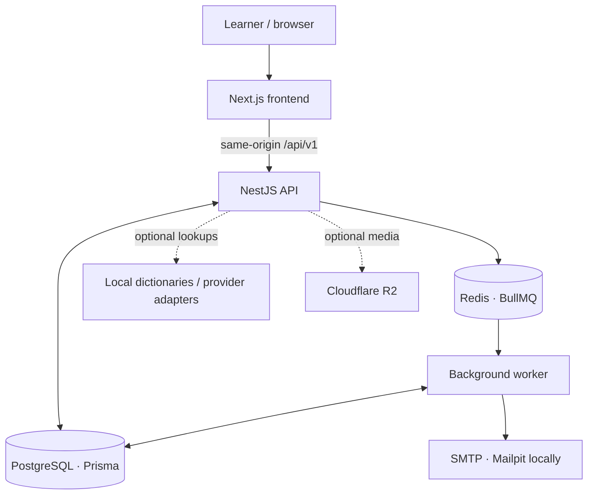

<p align="center">
  
</p>

<h1 align="center">Vocelune</h1>
<p align="center"><strong>A rhythm for every word.</strong></p>
<p align="center">
  An English vocabulary learning platform built around <strong>active recall</strong>,
  <strong>FSRS-6 spaced repetition</strong>, and measurable study progress.
</p>

<p align="center">
  <a href="#the-product">Product</a> ·
  <a href="#engineering-highlights">Engineering</a> ·
  <a href="#system-architecture">Architecture</a> ·
  <a href="#run-locally">Get started</a> ·
  <a href="#documentation">Documentation</a>
</p>

<p align="center">
  <a href="https://github.com/nmtrucworking/Vocelune/actions/workflows/ci.yml">
    
  </a>
  
  
  
</p>

---

## The product

Vocabulary learning involves more than collecting translations. Learners need a way to retrieve a word without prompts, decide when to revisit it, test understanding in different formats, and interpret their own progress.

**Vocelune brings those workflows into one application:**

1. **Recall first.** A flashcard's answer is revealed only after an attempt to remember it.
2. **Review at an adaptive interval.** The backend schedules reviews with `ts-fsrs` **5.4.2 (FSRS-6)** rather than relying on fixed intervals.
3. **Check what was learned.** Configurable tests and study analytics provide separate views of practice and assessment.

> **Scope:** Vocelune is a functional software project under active development. The repository does not establish a measured improvement in learning outcomes, nor does it currently establish production deployment readiness.

### What is implemented

| Area | Capabilities |
| --- | --- |
| **Study & recall** | Flashcard reveal, self-grading, adaptive due queue, daily new-card limits, suspend/reset, review undo, and per-card scheduling |
| **Vocabulary library** | Lexemes and individual senses, custom decks, tags, search, deduplication, topic groups, and publicly shared decks that users can clone |
| **Assessments** | Multiple choice, typed answers, listening, mixed tests, configurable filters and duration, autosave/resume, and server-side scoring |
| **Import & export** | CSV/XLSX templates, preview and validation, resumable import jobs, and CSV/XLSX/JSON export |
| **Dictionary enrichment** | Local lexical data and external provider adapters, pronunciation/IPA support, contextual sense selection, source attribution, and fallback controls |
| **Progress insights** | Activity history, streaks, retention-oriented summaries, review forecasts, and timezone-aware daily statistics |
| **Accounts & settings** | Email/password authentication, password reset, profile settings, session revocation, and account data export/deletion |

Dictionary providers can require their own API credentials and usage rights. A missing provider does **not** imply that Vocelune can fabricate definitions, pronunciations, or CEFR levels.

## Engineering highlights

The project is structured as a **TypeScript monorepo** with a Next.js frontend, a NestJS modular monolith, and a separate background worker.

| Design decision | Technical implementation | Reason |
| --- | --- | --- |
| **Scheduling on the server** | Pinned `ts-fsrs` version, versioned scheduler configuration, transactional review writes | Keep the study schedule consistent across clients and preserve review history |
| **Data integrity** | Prisma + PostgreSQL migrations, constraints, indexes, tenant checks, and audit records | Model vocabulary, reviews, and test attempts as durable domain data |
| **Safe retries** | Idempotency keys and concurrency checks around review/import operations | Reduce duplicate writes when requests are retried |
| **Asynchronous processing** | Redis/BullMQ worker with persistent job checkpoints and email outbox records in PostgreSQL | Separate longer-running imports and email processing from API requests |
| **Dictionary provenance** | Source-specific adapters, field-level persistence rules, quotas/cooldowns, and local fallback | Avoid assuming that every provider permits unrestricted storage or redistribution |
| **Session protection** | HttpOnly opaque sessions, CSRF validation, request throttling, password hashing, and strict request schemas | Apply explicit controls to account and data-changing operations |

These are **implementation choices**, not claims of independent security certification, high-load performance, or clinical/educational effectiveness.

### Technology stack

| Layer | Technology |
| --- | --- |
| Frontend | Next.js 15, React 19, TypeScript, Tailwind CSS, Framer Motion, Recharts |
| Backend | NestJS 11, Node.js, TypeScript, Zod, Swagger / OpenAPI |
| Persistence | PostgreSQL, Prisma 6 |
| Background jobs | Redis, BullMQ, independent worker process |
| Study scheduling | `ts-fsrs` 5.4.2 / FSRS-6 |
| Media & integrations | Optional Cloudflare R2, dictionary providers, SMTP |
| Verification & packaging | Node test runner / Supertest, GitHub Actions, Docker |

## System architecture



The API contains modules for **Identity, Vocabulary, Study, Tests, Transfer, Integrations, and Analytics**. Review scheduling and scoring are implemented server-side; the worker handles deferred processing.

<details>
<summary><strong>Repository layout</strong></summary>

```text
Vocelune/
├── apps/
│   ├── frontend/       # Next.js application and design system
│   └── backend/        # NestJS API, Prisma, worker and tests
├── docs/               # Requirements, backend, dictionary and deployment notes
├── infra/              # Container build definitions
├── scripts/            # Local setup, development and verification
├── .github/workflows/  # CI pipeline
├── docker-compose.yml  # Local supporting services
└── package.json        # npm workspaces
```

</details>

## Run locally

**Prerequisites:** Node.js **22.19+** (Node 24 is used in CI), npm, and Docker Desktop / Docker Engine with Compose.

```bash
git clone https://github.com/nmtrucworking/Vocelune.git
cd Vocelune
npm ci
npm run setup
npm run dev
```

`npm run setup` creates a backend `.env` when one is not present, generates a local email encryption key, starts supporting services, and applies PostgreSQL migrations. It does not overwrite an existing `.env` or create a default account.

| Service | Local URL |
| --- | --- |
| Web application | [localhost:3000](http://localhost:3000) |
| API health/readiness | [localhost:4000/api/v1/health/ready](http://localhost:4000/api/v1/health/ready) |
| Swagger UI | [localhost:4000/api/docs](http://localhost:4000/api/docs) |
| Mailpit inbox | [localhost:8025](http://localhost:8025) |

Create an account through the local UI. `npm run dev` starts the frontend, API, and worker; use `npm run dev:frontend`, `npm run dev:backend`, or `npm run worker` for individual processes.

### Verify the codebase

```bash
npm run typecheck
npm test
npm run build
npm audit --omit=dev
```

The backend test workflow provisions an isolated PostgreSQL test database, applies migrations, exercises API behavior, and removes the test database afterward. Its database credentials require `CREATE DATABASE` privileges. **Do not use production credentials when running the tests.**

GitHub Actions runs installation, Prisma client generation, type checks, tests, build, and a dependency audit. The CI badge above links to its current execution status; a successful build alone does not demonstrate deployment readiness.

## Project status & limitations

- **Active development:** the codebase contains implemented application flows and automated tests, but a public production demo has not been verified for this README.
- **Deployment validation:** the [29 October 2026 readiness review](docs/DEPLOY_READINESS.md) identified deployment-configuration issues. Consult it and re-test the current code before asserting production readiness; the report reflects the repository state examined at that time.
- **External services:** Oxford and other dictionary integrations, email delivery, and R2 media features depend on configuration, API availability, and applicable licenses.
- **Portfolio evidence:** add genuine screenshots and a verified demo URL when they are available; no simulated screenshots or performance claims are presented here.

## Documentation

- [Software requirements specification](docs/SRS_English_Vocabulary_Learning_Platform_v1.0.md)
- [Backend architecture, data model & API conventions](docs/backend.md)
- [Dictionary sources, configuration & licensing](docs/DICTIONARY.md)
- [Deployment readiness findings](docs/DEPLOY_READINESS.md)
- [Deployment guide](docs/DEPLOYMENT.md) — verify against the readiness findings before following for production
- [Brand identity guidelines](docs/Vocelune_Branding_Guide_v1.0.md)

## Licensing

No open-source license is currently specified in this repository. Public source visibility does not automatically grant permission to reuse, modify, or redistribute the code. Contact the repository owner about permissions.

---

<p align="center">
  <strong>Vocelune</strong> · Vocabulary learning & recall<br />
  <sub>Product, code, architecture, and implementation details are documented for technical review.</sub>
</p>
