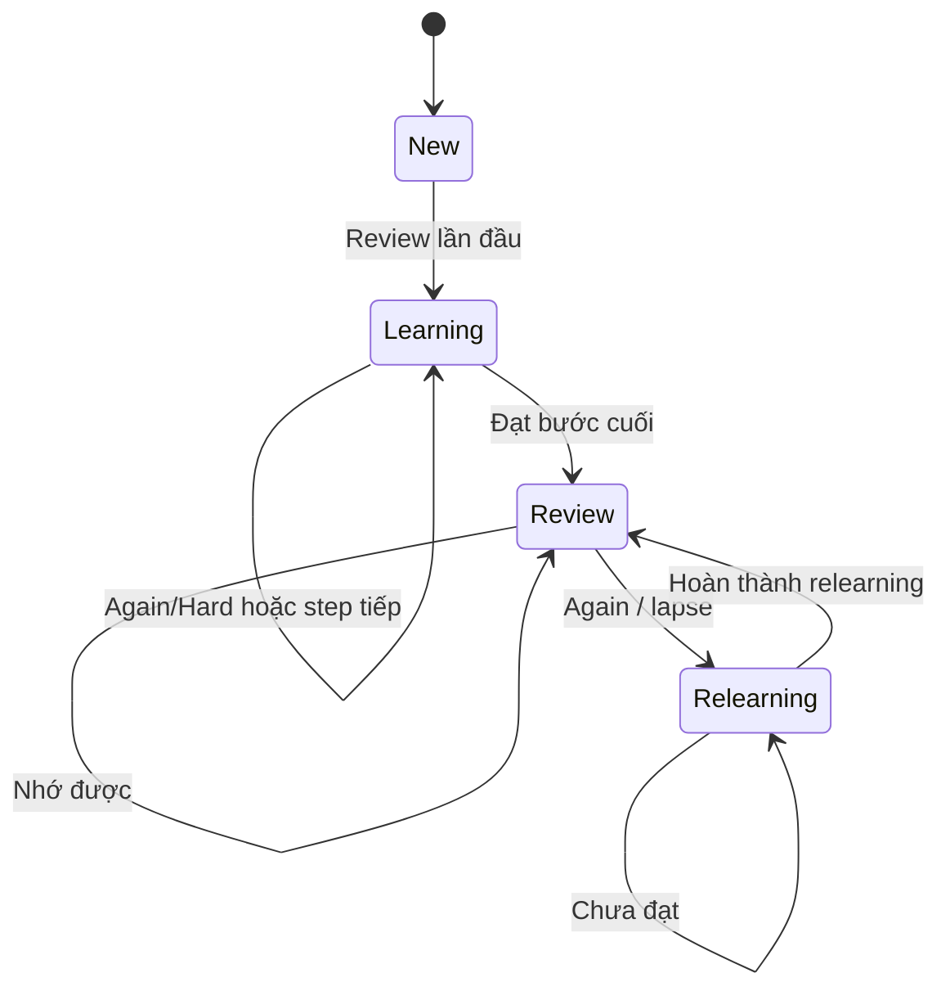
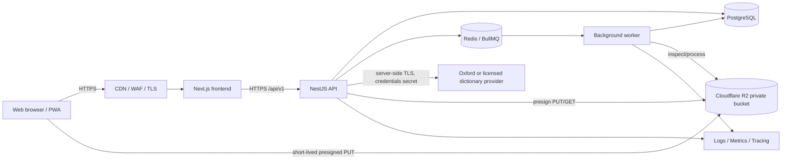
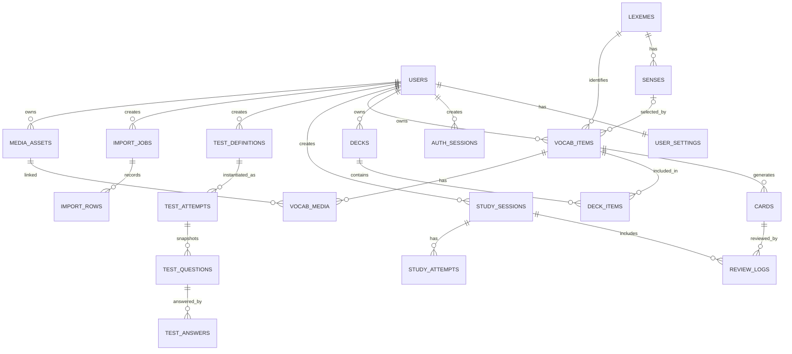
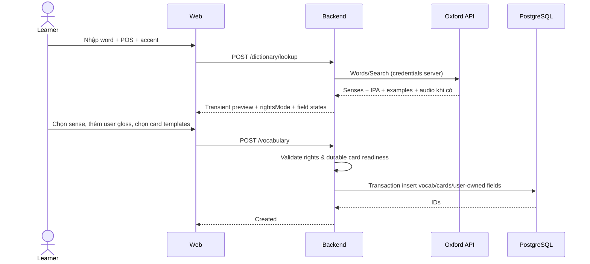
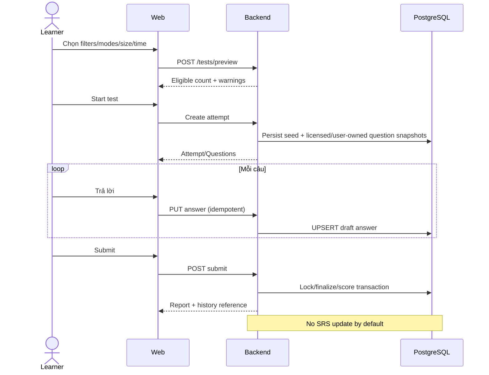

# SOFTWARE REQUIREMENTS SPECIFICATION (SRS)
## English Vocabulary Learning Platform — Spaced Repetition + Active Recall

| Thuộc tính | Giá trị |
|---|---|
| Mã tài liệu | EVLP-SRS-001 |
| Phiên bản | 1.0.0 — bản đặc tả cơ sở |
| Ngày biên soạn | 27/10/2026 |
| Ngôn ngữ sản phẩm | Tiếng Việt mặc định; hỗ trợ giao diện tiếng Anh |
| Đối tượng | Product Owner, UI/UX, Frontend, Backend, Database, QA, DevOps |
| Phạm vi | Website responsive, multi-user, ứng dụng web trước; có thể mở rộng PWA/mobile |
| Mức độ | Software Requirements Specification + Solution Architecture + Acceptance Criteria |
| Trạng thái | Proposed — cần chốt giấy phép nguồn từ điển và yêu cầu phi chức năng trước production |

> **Quy ước:** **MUST** = bắt buộc; **SHOULD** = nên có; **MAY** = tùy chọn. **P0** = MVP; **P1** = mở rộng gần; **P2** = tương lai. Mọi mục có mã `FR`, `NFR`, `BR`, `AC` phục vụ traceability. Con số hiệu năng là **mục tiêu thiết kế đề xuất**, không phải số đo hiện hữu.

---

## 0. Tóm tắt điều hành và các quyết định then chốt

Xây dựng hệ thống để người học (1) tạo kho từ vựng có ngữ cảnh, (2) học bằng **active recall** trước khi xem đáp án, (3) lập lịch ôn tập theo **FSRS** như một thuật toán spaced repetition, (4) thực hiện bài luyện tập và bài kiểm tra tùy biến, (5) theo dõi tiến bộ qua dữ liệu review/test độc lập, (6) nhập nhanh từ đơn lẻ hoặc bảng tính, (7) quản lý hồ sơ, mục tiêu và lịch sử.

**Các quyết định kiến trúc:**

1. **Một thẻ (card) là một đơn vị trí nhớ riêng**, được liên kết với *từ + từ loại + nghĩa cụ thể (sense) + chiều truy hồi*. Không gộp lịch học cho mọi nghĩa của một từ.
2. **FSRS là engine lập lịch**, được cấu hình và phiên bản hóa. Không tự chế lịch cố định kiểu `1–3–7–14` rồi gọi là FSRS. FSRS không phải một chuẩn ISO bắt buộc; “chuẩn SRS” trong tài liệu này có nghĩa áp dụng đúng mô hình, thuật toán, kiểm thử và log.
3. **Practice/Study** và **Exam/Test** là hai ngữ cảnh riêng. Bài test mặc định **không** thay đổi lịch SRS; chỉ khi người dùng chủ động chọn “Ghi kết quả vào lịch ôn” và kết quả đáp ứng điều kiện chấm điểm thì mới cập nhật.
4. **Oxford Dictionaries API là nhà cung cấp tùy chọn theo giấy phép**. Theo FAQ chính thức, việc cache/lưu dữ liệu Oxford để sử dụng offline yêu cầu **Enterprise licence**. Vì vậy hệ thống có hai chế độ `LIVE_ONLY` và `PERSIST_LICENSED`; không thiết kế việc lưu toàn bộ definition/example/audio mặc nhiên. Phải xác nhận điều khoản cụ thể trước khi triển khai tính năng lưu tự động. [R1][R2]
5. **CEFR không mặc định có sẵn trong mọi response tra từ của Oxford Dictionaries API**. Phân lớp A1–C1 từ danh sách Oxford 3000/5000 là một nguồn/tài sản nội dung riêng, cần quyền sử dụng và mapping theo `lemma + part_of_speech` phù hợp. Nếu không có dữ liệu được cấp quyền, trả `unknown` và cho phép nhập thủ công có provenance; tuyệt đối không gán bừa A1–C2. [R3][R4]
6. **PostgreSQL là nguồn dữ liệu xác thực**, R2 chỉ chứa binary assets được phép lưu (ảnh do user tải, voice tự sản xuất/được cấp quyền), Redis là lớp cache/queue không có tính chất nguồn dữ liệu chính.
7. Đề xuất **modular monolith** giai đoạn đầu, tách worker không đồng bộ, tránh microservices khi chưa có nhu cầu vận hành xác nhận.

### 0.1 Giả định cần xác thực

- Đối tượng chính: cá nhân tự học tiếng Anh, giao diện VN, nghĩa tiếng Việt + định nghĩa tiếng Anh; hỗ trợ đa tài khoản, dữ liệu riêng tư mặc định.
- Từ vựng ban đầu thuộc sở hữu do người dùng nhập hoặc nội dung nhà cung cấp cấp phép hợp lệ. Chưa có kho Oxford thương mại sẵn có.
- Chi phí cho Oxford API, bản quyền nội dung/audio, dịch vụ email, lưu trữ và CDN **không** mặc định bằng 0.
- Dự án có thể chạy tại một vùng hạ tầng trước; yêu cầu residency và pháp lý theo thị trường triển khai phải được rà soát riêng.

## 1. Mục tiêu, đối tượng và chỉ số thành công

### 1.1 Product outcomes

| ID | Outcome | Đo lường đề xuất | Lưu ý phương pháp |
|---|---|---|---|
| G-01 | Người dùng có thể bắt đầu học nhanh | Thời gian từ login → tạo thẻ → trả lời lần đầu | Đo riêng theo cohort mới |
| G-02 | Học dựa trên truy hồi chứ không chỉ đọc lại | Tỷ lệ lượt học có bước chủ động trả lời trước khi reveal | Không đánh đồng số lần bấm với chất lượng nhớ |
| G-03 | Ôn đúng lúc | Tỷ lệ cards đến hạn được xử lý; backlog cuối ngày | Tính theo múi giờ user; không “phạt” những lần không mở app |
| G-04 | Đánh giá tiến bộ theo lịch sử | Retention thực nghiệm, kết quả test, độ phủ kho từ, thời gian học | Có mẫu số, cỡ mẫu và khoảng thời gian rõ ràng |
| G-05 | Nhập từ nhanh có kiểm soát | Tỷ lệ lookup thành công, tỷ lệ cần sửa sense, thời gian nhập từ | Phân biệt user-entered và vendor-provided |

### 1.2 Tác nhân

- **Guest:** xem landing/pricing/chính sách; đăng ký và đăng nhập.
- **Learner:** quản lý từ vựng, deck, cards, lịch ôn, tests, lịch sử, profile; chỉ thao tác trên tài nguyên được cấp quyền.
- **Admin:** quan sát health, job/import/quota, quản trị cấu hình và xử lý hỗ trợ có audit; mặc định không xem nội dung riêng tư của learner khi không cần thiết.
- **Dictionary provider:** hệ thống ngoài trả từ điển; không được coi là nguồn dữ liệu luôn sẵn có.
- **Async worker:** xử lý import, tổng hợp thống kê, media processing, notification, tác vụ tái lập lịch hợp lệ.

## 2. Phạm vi sản phẩm và ưu tiên

| Phạm vi | P0 — phát hành đầu | P1 — giai đoạn kế | P2 — sau này |
|---|---|---|---|
| Identity | Email/password, reset mật khẩu, hồ sơ, settings | OAuth Google, đăng nhập nhiều thiết bị | SSO tổ chức |
| Vocabulary | CRUD từ/định nghĩa/sense, decks, tags, search/filter | bulk edit, synonym/antonym, collections | chia sẻ bộ từ công khai, moderation |
| Enrichment | `word + POS → preview`, Oxford adapter có điều kiện, sửa nội dung | nhiều provider, source comparison | contextual AI suggestions với provenance |
| Import/export | CSV/XLSX template, preview, validate, import job; CSV export user data | nhập qua Google Sheets OAuth hoặc link được phép | đồng bộ hai chiều có conflict resolution |
| SRS | FSRS 4 mức, review queue, undo, lịch sử | tối ưu tham số theo người dùng, notifications | offline sync/PWA |
| Study | flashcard recall, typed answer, MCQ, audio recognition | cloze, matching, sentence ordering | luyện nói tự động có đánh giá mô hình |
| Tests | random/filter/size/direction/time, score, lịch sử | test blueprint lưu sẵn, phân tích theo chủ đề | adaptive testing được hiệu chuẩn |
| Analytics | dashboard, activity, review/test trend, retention | cohort, forecast, confidence intervals | phân tích kiến thức theo kỹ năng |
| Media | ảnh trong flashcard bằng R2 | xử lý thumbnail/webp, audio riêng có quyền | video, OCR |

**Ngoài phạm vi P0:** social feed, gamification phức tạp, AI chấm phát âm chuẩn bản ngữ, bảo đảm CEFR tự động cho mọi từ, scrape website Oxford, offline hóa tài sản Oxford khi không có license, mô hình “đo trí nhớ tuyệt đối” dựa trên một chỉ số.

## 3. Thuật ngữ và nguyên tắc học tập

| Thuật ngữ | Định nghĩa |
|---|---|
| Lexeme | Đơn vị từ vựng ở dạng chuẩn (lemma), kèm locale/ngôn ngữ |
| POS | Part of speech: noun, verb, adjective, adverb, ... |
| Sense | Một nghĩa cụ thể của lexeme theo POS; có thể có ví dụ, ngữ cảnh riêng |
| Vocab item | Một nghĩa/từ người dùng đưa vào kho cá nhân |
| Note | Nội dung kiến thức nguồn sinh ra một hoặc nhiều card |
| Card | Bài truy hồi đơn lẻ có một hướng hỏi–đáp và lịch SRS riêng |
| Due | Thời điểm card đến hạn; **lưu UTC** |
| Active recall | Đòi hỏi người học tự gợi nhớ/đáp ứng trước khi nhìn đáp án |
| FSRS | Free Spaced Repetition Scheduler; sử dụng memory state và rating để tính lịch |
| `R`, `S`, `D` | Retrievability, Stability, Difficulty của mô hình FSRS; ý nghĩa/công thức phụ thuộc phiên bản engine |
| Lapse | Một lần quên trong state Review và phải học lại |
| Review log | Event bất biến ghi một lần cập nhật lịch SRS |
| Test attempt | Phiên đánh giá lưu câu hỏi, câu trả lời, điểm và snapshot cấu hình |
| CEFR | Khung A1, A2, B1, B2, C1, C2; `unknown` khi không có nguồn tin cậy |

**BR-01.** Học viên phải có cơ hội trả lời trước khi xem mặt sau/đáp án. **BR-02.** Đơn vị xếp lịch là card, không phải raw word. **BR-03.** Dữ liệu test, review và study attempt được phân loại độc lập. **BR-04.** Mọi chỉ số tiến độ phải kèm tập dữ liệu, định nghĩa mẫu số và khoảng thời gian.

## 4. Yêu cầu chức năng tổng quát (Functional Requirements)

| ID | Ưu tiên | Tính năng / hành vi bắt buộc | Tiêu chí nghiệm thu tóm tắt |
|---|---|---|---|
| FR-AUTH-01 | P0 | Đăng ký, email verification tùy rollout, login/logout, quên mật khẩu | Xác thực và revoke phiên hoạt động |
| FR-AUTH-02 | P0 | Hồ sơ: avatar, tên hiển thị, timezone, mục tiêu, dialect, theme, ngôn ngữ | Lưu/đọc được và áp dụng xuyên app |
| FR-AUTH-03 | P0 | Xóa tài khoản và xuất dữ liệu thuộc sở hữu user | Có xác nhận và xử lý theo retention policy |
| FR-VOC-01 | P0 | CRUD lexeme/note/vocab item, nhiều sense/POS | Không overwrite nghĩa khác của cùng chính tả |
| FR-VOC-02 | P0 | Tạo/sửa/xóa deck, tags, tìm kiếm/filter/sort | Chỉ thấy dữ liệu có quyền |
| FR-VOC-03 | P0 | Tạo cards qua template hỏi–đáp, EN→VI, VI→EN, audio→word | Mỗi card có lịch riêng |
| FR-VOC-04 | P0 | Merge duplicate có xem trước, giữ lại review logs | Không mất dữ liệu lịch sử |
| FR-ENR-01 | P0 | Gửi word + POS + dialect → adapter tra từ | Trả candidate, sense và provenance có trạng thái trường |
| FR-ENR-02 | P0 | Preview và chọn nghĩa trước khi thêm vào kho | Không save nhầm sense do tự động đoán |
| FR-ENR-03 | P0 | IPA, examples, audio khi provider cho phép và có dữ liệu | `unavailable` có fallback, không điền giả |
| FR-ENR-04 | P0 | CEFR có nguồn/độ tin cậy, `unknown` nếu chưa xác minh | Không khẳng định Oxford API luôn trả CEFR |
| FR-ENR-05 | P0 | Tôn trọng chế độ licensing (`LIVE_ONLY`, `PERSIST_LICENSED`) | Không persist tài sản vendor khi chưa được phép |
| FR-IMP-01 | P0 | Tải template `.xlsx` và `.csv` | Có header, hướng dẫn, ví dụ synthetic |
| FR-IMP-02 | P0 | Upload CSV/XLSX, mapping cột, preview, phát hiện trùng/lỗi | Import theo hàng, có báo cáo |
| FR-IMP-03 | P0 | Retry và idempotency cho import job | Re-upload không vô tình nhân đôi dữ liệu |
| FR-EXP-01 | P0 | Xuất vocab do user sở hữu + trạng thái học/lịch sử | Xuất file có giới hạn bảo mật và quyền nội dung |
| FR-SRS-01 | P0 | Due queue phân biệt new/learning/review/relearning | Dữ liệu đúng trạng thái và server time |
| FR-SRS-02 | P0 | Reveal rồi chọn Again/Hard/Good/Easy | Rating chỉ xuất hiện sau reveal |
| FR-SRS-03 | P0 | Cập nhật lịch bằng FSRS server-side trong transaction | Mỗi submission chỉ ghi một event |
| FR-SRS-04 | P0 | Undo review cuối gần nhất, có ràng buộc concurrency | Phục hồi card và log có kiểm toán |
| FR-SRS-05 | P0 | Suspend/unsuspend, reset card, giới hạn thẻ mới/ngày | Không làm sai history hoặc mất audit |
| FR-SRS-06 | P0 | Người dùng thay mục tiêu retention theo giới hạn cấu hình | Có chính sách áp dụng mới và version tracking |
| FR-STD-01 | P0 | Flashcard active recall | Mặt sau chỉ hiện sau hành động Reveal |
| FR-STD-02 | P0 | Typing/spelling, MCQ, audio recognition | Có chấm điểm và giải thích kết quả |
| FR-STD-03 | P1 | Cloze, matching, word ordering, contextual exercises | Nội dung hợp lệ, có distractor phù hợp |
| FR-TST-01 | P0 | Test builder: deck/tag/CEFR/POS/status, size, order, direction, modes, duration | Preview số câu đủ điều kiện |
| FR-TST-02 | P0 | Test snapshot, autosave, submit, timeout, lịch sử | Resume/submit không ghi đè kết quả |
| FR-TST-03 | P0 | Score, correctness, answer review, phân tích theo subset | Chấm theo phiên bản rubric cố định |
| FR-TST-04 | P0 | Không cập nhật SRS từ test theo mặc định | Tách test analytics và SRS reviews |
| FR-DASH-01 | P0 | Dashboard KPI, heatmap, xu hướng, đến hạn, độ phủ | Metrics được định nghĩa, đúng timezone |
| FR-DASH-02 | P0 | Lịch sử và phân tích bài test; biểu đồ theo thời gian | Có filter, mẫu số rõ ràng |
| FR-DASH-03 | P1 | Forecast due, retention theo cohort, phân tích lapses | Nêu rõ đó là dự báo, không phải thực đo |
| FR-MED-01 | P0 | Upload ảnh thẻ qua R2, kiểm tra và xác nhận | Quyền sở hữu, MIME, size, malware policy |
| FR-MED-02 | P1 | Tạo ảnh thumbnail, dọn orphan objects | DB vẫn là nguồn quyền truy cập |
| FR-ADM-01 | P0 | Admin metrics, provider quota, job status, audit | Bảo vệ role + audit access |
| FR-NOT-01 | P1 | Reminder theo khung giờ và timezone | User opt-in, hủy đăng ký được |

## 5. Chi tiết module Vocabulary / Dictionary

### 5.1 Mô hình dữ liệu ngôn ngữ

**BR-VOC-01:** cặp `spelling + POS` vẫn có thể có **nhiều sense**. Ví dụ `bank/noun` không đồng nghĩa giữa “ngân hàng” và “bờ sông”. `run/verb` và `run/noun` là các lexeme/POS khác nhau dù trùng chữ. Các biến thể Anh–Anh/Anh–Mỹ có cách phát âm khác nhau.

- `lexeme`: lemma chuẩn, display spelling, language (`en`), lexical category, provider references.
- `sense`: một nghĩa có định danh nội bộ và provider sense reference (khi có), định nghĩa EN, nghĩa VI, examples, labels, CEFR và provenance; chỉ lưu vendor content nếu license cho phép.
- `vocab_item`: một entry trong kho riêng user tham chiếu sense hoặc nội dung user-authored, tags, note, priority, created_at.
- `card`: tạo từ `vocab_item` + template, gán nội dung câu hỏi / câu trả lời theo quyền sử dụng; một `vocab_item` có thể sinh nhiều cards.
- **Conflict policy:** người dùng sửa phần riêng (`user_gloss`, `user_example`, `mnemonic`) không mất sau refresh nguồn; tách quyền sở hữu nội dung nguồn và nội dung user.
- **Uniqueness:** chống duplicate theo `(user_id, lexeme_id, sense_key, custom_context_key)` khi key có đủ dữ liệu; khi chưa có sense id, cho phép giữ cùng chính tả nhưng hiện cảnh báo/phương án hợp nhất.

### 5.2 Nhập nhanh `word + type` 

1. FE nhận `word`, `part_of_speech`, `dialect` (`en-gb`/`en-us`); debounce lookup khi cần, nút Tra từ là hành động rõ ràng.
2. BE validate input, kiểm soát rate limit, gọi `DictionaryProvider` (Oxford adapter); **không gửi credential tới browser**.
3. Adapter xử lý inflection theo endpoint **Words**; nếu input sai/chưa rõ, dùng **Search → Words**. Parse candidates/senses/IPA/audio/definitions/examples và POS. [R2]
4. FE hiển thị **preview từng sense**, không tự động kết luận nghĩa từ `word + type`; user chọn sense phù hợp, chỉnh sửa ghi chú/ý nghĩa của mình, tags/decks/cards.
5. CEFR lookup riêng bằng bộ dữ liệu **được cấp quyền**; match `lemma + POS` và, nếu dữ liệu cho phép, sense; trả `unknown` nếu không xác định.
6. Trước nút **Save**, BE đánh giá `persist_policy`. Trong `LIVE_ONLY`, dữ liệu Oxford chỉ dùng để hiển thị trong phiên được cho phép, **không ghi vào DB/Redis/R2/logs/export/training data**. Chỉ lưu định danh từ, tags, và nội dung người dùng tự biên soạn một cách độc lập; không dùng thao tác "Save" như một cách sao chép nguyên văn vendor content. Trong `PERSIST_LICENSED`, lưu các trường cụ thể được hợp đồng cấp phép.
7. Nếu provider 404/429/5xx hoặc khóa license hết hạn, vẫn cho phép **manual entry**. Không khóa học/review do nguồn từ điển lỗi; nếu một card cần nội dung vendor không được phép persist thì yêu cầu user-owned field trước khi tạo lịch bền vững.

**Trạng thái cấp từng trường:** `available`, `unavailable`, `requires_license`, `user_supplied`, `not_verified`. **Nguồn dữ liệu:** `provider`, `source_url/reference`, `retrieved_at`, `license_mode`, `confidence` (chỉ khi có cách định lượng được), `verified_by`.

#### Contract enrichment minh họa (đặc tả nội bộ, không phải payload Oxford)

```json
{
  "query": { "word": "abandon", "partOfSpeech": "verb", "dialect": "en-gb" },
  "provider": "oxford",
  "licenseMode": "LIVE_ONLY",
  "candidates": [
    {
      "lemma": "abandon",
      "partOfSpeech": "verb",
      "providerEntryRef": "opaque-reference",
      "senses": [
        {
          "providerSenseRef": "opaque-sense-reference",
          "definition": { "status": "available", "value": "<transient-provider-text>" },
          "examples": { "status": "available", "items": ["<transient-provider-example>"] },
          "pronunciations": [{ "dialect": "en-gb", "ipa": "<provider-ipa>", "audio": { "status": "available", "playbackUrl": "<authorized-transient-url>" } }],
          "cefr": { "status": "not_verified", "value": null, "source": null }
        }
      ]
    }
  ],
  "warnings": ["Vendor content may not be stored in LIVE_ONLY mode."]
}
```

**Không** hardcode hoặc phụ thuộc vào JSON structure chưa xác nhận của Oxford; adapter định nghĩa schema trong ứng dụng và có contract tests chạy trên sandbox/plan thực tế.

### 5.3 Quy tắc CEFR / accent / pronunciation

- CEFR cho phép `A1,A2,B1,B2,C1,C2,unknown`; có cột `cefr_source`, `cefr_method` (`licensed_list/manual/estimated`), `cefr_verified_at`. `estimated` phải hiển thị khác `verified`, không coi là Oxford-certified.
- Oxford 3000 bao gồm A1–B2; Oxford 5000 bổ sung B2–C1, **không bao phủ mọi từ hoặc C2**. [R3][R4]
- Phát âm: nhiều dialect và IPA; audio là URL được phép phát **không mặc định được phép copy sang R2**.
- Nghĩa tiếng Việt: Oxford monolingual lookup không tự nhiên đồng nghĩa với Vietnamese translation. Muốn có nghĩa VI tự động phải xác minh bộ dữ liệu song ngữ `en→vi` được plan hỗ trợ hoặc dùng nguồn hợp lệ khác; nếu không, nhận user-entered gloss.

## 6. Nhập bảng tính và xuất dữ liệu

### 6.1 Template

Download `vocabulary-import-template.xlsx` và `.csv`, có tab **Instructions**, **Vocabulary**, **Enums** (XLSX), 3 dòng minh họa giả lập được gắn `example_only=true` để tránh nhập nhầm. UTF-8/BOM hợp lệ; giới hạn MVP **5.000 rows/file, 10 MB/file** (đề xuất cấu hình được).

| Cột | Bắt buộc | Kiểu | Quy tắc |
|---|---|---|---|
| `word` | YES | string | Trim, Unicode normalize, 1–100 ký tự; giữ original display |
| `part_of_speech` | YES | enum | `noun`, `verb`, `adjective`, `adverb`, `phrase`, `other`,... |
| `meaning_vi` | Conditional | string | Bắt buộc khi không có nguồn nội dung có quyền lưu |
| `definition_en` | NO | string | User-authored hoặc đã có quyền nhập |
| `example_en` | NO | string | Gắn đúng sense |
| `example_vi` | NO | string | Không áp đặt bắt buộc |
| `ipa` | NO | string | Không suy luận nếu trống |
| `dialect` | NO | enum | Default theo profile: `en-gb` hoặc `en-us` |
| `cefr_level` | NO | enum | `A1`...`C2`, `unknown`; nhập tay → nguồn `manual` |
| `deck` | NO | string | Tạo hoặc map theo tên dưới user hiện tại |
| `tags` | NO | string | Dấu phân cách `;` theo hướng dẫn |
| `note` | NO | string | Mnemonic cá nhân |
| `card_templates` | NO | string | VD `en_vi;vi_en`; kiểm tra trường cần thiết |
| `source_note` | NO | string | Người dùng mô tả nguồn, không mặc định là Oxford |

**Import flow:** tải template → chọn file hoặc drag-drop → parse theo stream/job → map cột → validate + preview (dòng, nguyên nhân lỗi, duplicate detection) → chọn `skip/merge/create_new` trong trường hợp phù hợp → confirm → commit theo chunks bằng transaction → summary (`created`, `updated`, `skipped`, `failed`) → tải error report; job resume với idempotency key.

**Bảo vệ:** giới hạn ZIP bomb/XXE khi xử lý XLSX, giới hạn rows/cells, không thực thi formulas/macros, sanitize CSV để không kích hoạt spreadsheet formula khi export (ký tự mở đầu `=`, `+`, `-`, `@`), không để cột được map vượt quyền sở hữu, không tự động gọi Oxford cho hàng loạt không kiểm soát quota; optional background enrichment queue ở P1 **chỉ khi license và rate limit phù hợp**.

### 6.2 Google Sheets (P1)

- Tùy chọn: OAuth scopes **read-only tối thiểu** của Google Sheets; user chọn sheet/tab/range, preview, ánh xạ tương tự XLSX.
- Không lấy sheet bất kỳ từ URL thiếu xác thực hoặc vượt sharing policy. Nếu dùng sheet công khai qua export URL, phải kiểm tra SSRF/host allowlist.
- Sheet import là **snapshot tại thời điểm xác nhận**, không phải live sync. Lưu `source_document_ref` có thể tắt/xóa; không lưu token dưới dạng plaintext.

### 6.3 Export

Export CSV/XLSX/JSON đối với nội dung người dùng sở hữu, deck, cards, FSRS states/review logs, test history ở định dạng tương thích và có version; lọc bỏ toàn bộ dữ liệu Oxford không có quyền xuất; file export được cấp link tải ngắn hạn và hết hạn tự động.

## 7. Study engine: Active Recall + Spaced Repetition

### 7.1 Các mode

| Mode | Hỏi | Trả lời / chấm | Là SRS review? | P |
|---|---|---|---|---|
| Flashcard Recall | EN / VI / cloze theo template | Tự nhớ → Reveal → tự chọn Again/Hard/Good/Easy | YES khi đi từ due queue | P0 |
| Typed Recall | Gợi ý/nghĩa → người dùng gõ EN | So khớp normalization; cho override nếu chấp nhận alias | Có thể, nếu rating sau reveal | P0 |
| Multiple Choice | EN/VI → 4 đáp án có nhiễu | Chọn 1; lưu chính xác và thời gian | Mặc định NO cho practice tự do; cho YES nếu vào due flow, nhưng không ánh xạ đúng/sai ngây thơ thành 4 rating | P0 |
| Listening / Audio | Voice → chọn/gõ từ | Nghe trước khi reveal; có audio fallback hợp lệ | Tùy flow card audio | P0 |
| Cloze | Câu bị che token/phrase | Gõ token theo ngữ cảnh | Tùy flow | P1 |
| Matching | Ghép EN/VI hoặc phrase/sense | Chấm theo cặp | NO theo mặc định | P1 |
| Sentence ordering | Xếp câu từ các token | Chấm thứ tự/ngữ pháp | NO theo mặc định | P1 |
| Quick Browse | Lật/đọc nhanh | Không yêu cầu recall | NO; không tính là “đã nhớ” | P0 |

**MCQ chống ghi nhớ máy móc:** distractors cùng POS, cùng trường nghĩa hoặc difficulty vừa đủ; không đưa distractor đồng nghĩa gây nhập nhằng; có câu hỏi đánh giá khác nhau cho recognition vs production; chống lặp vị trí đáp án. Với TTS, không khẳng định đây là voice Oxford. Các trường `audio_source`, `audio_license` hiển thị thông tin nguồn.

### 7.2 FSRS specification

**Chọn giải pháp:** triển khai `SchedulerAdapter` gọi thư viện TypeScript FSRS được duy trì, **pin model version + package version + parameter set**. Tại thời điểm viết, tài liệu `ts-fsrs` trình bày API mới hỗ trợ **FSRS-7** và các model cũ; version chạy production phải chốt bằng lockfile, integration tests và migration policy, **không nâng model âm thầm**. [R5][R6]

Các trạng thái scheduler: `new`, `learning`, `review`, `relearning` cùng `suspended` ở lớp policy. Rating user: `Again=1`, `Hard=2`, `Good=3`, `Easy=4`. Memory state và cách tính interval được ủy nhiệm hoàn toàn cho model + middleware/implementation version. Không tự viết công thức FSRS rút gọn vào BE.

**Cấu hình đề xuất cho MVP** (mọi giá trị do PO phê duyệt, không phải thông số bắt buộc FSRS):

| Tham số | Default | Quy tắc |
|---|---|---|
| Desired retention | `0.90` | Allow `0.85–0.95` sau thông báo trade-off workload |
| New cards/day | `20` | 0–1000, tùy user, tách deck khi P1 |
| Review cards/day | Không hard cap mặc định | Cho soft cap/time budget; không xóa due backlog |
| Learning steps | `1m, 10m` | Phụ thuộc scheduler version; cấu hình explicit |
| Relearning steps | `10m` | Không sửa lịch sử cũ |
| Max interval | `36500d` | Cấu hình; không cho overflow |
| Day boundary | `04:00` local | Cấu hình, chỉ dùng làm ranh giới thống kê/ngày học, không đổi UTC due |
| Timezone | `Asia/Ho_Chi_Minh` mặc định UI | Mặc định theo profile; ngày học tính bằng IANA timezone |
| Leech threshold | `8` lapses | Tag + đề nghị suspend, không xóa review log |
| Bury siblings | Enabled | Tránh học nhiều card cùng sense trong một ngày, không cản learning cần đến hạn |

**BR-SRS-01 — time & due:** mọi timestamp lưu UTC `timestamptz`, `due_at <= server_now` mới đến hạn. Learning cards due cùng phiên có thể đến hạn tính phút. Đổi timezone không thay đổi actual `due_at`; day-boundary dùng local day của user.

**BR-SRS-02 — queue:** lấy `learning/relearning due` → `review due` → `new` theo giới hạn. Trong nhóm có thể trộn có kiểm soát để tránh recency bias; `buried`, `suspended`, `deleted` không vào queue. Khi không đủ data cho card (ví dụ glossary không có quyền persist/không có user answer), card ở `draft` và không vào queue.

**BR-SRS-03 — rating transaction:**

```text
FE loads due card + server schedule-preview token
User tries to recall -> reveal -> submits Again/Hard/Good/Easy
BE validates auth, card ownership, state, version, requestId
BEGIN TX
  SELECT cards WHERE id=? AND user_id=? FOR UPDATE
  if requestId already handled: return previous result
  verify expected card version and review cutoff
  next = SchedulerAdapter.review(previous_state, grade, now, frozen_params)
  INSERT immutable review_log (before, grade, after, source, requestId)
  UPDATE cards SET model_state=next, due_at=next.due, version=version+1
COMMIT
Return nextDue, state, logId, queue counts
```

**BR-SRS-04 — concurrency / retry:** `UNIQUE (user_id, client_request_id)` cho review requests; kiểm tra optimistic concurrency `card.version`; transaction row lock, server timestamp; response `409 STALE_CARD` nếu state bị thay đổi từ thiết bị khác, không phát sinh review thứ hai. Retry cùng request trả cùng kết quả đã lưu (ngay cả khi response trước mất).

**BR-SRS-05 — undo:** cho undo **lượt review cuối cùng của cùng card khi chưa có review tiếp theo**, trong cửa sổ mặc định 30 giây. Sử dụng reverse data/rollback của scheduler và log trạng thái `voided_at`, không xóa event; undo phải atomic/idempotent; khi hết điều kiện báo lý do. Có thể mở rộng admin repair bằng replay logs.

**BR-SRS-06 — parameter changes:** tạo `scheduler_config_version`; sự kiện mới dùng version mới; **không tự rewrite lịch cũ** trong transaction thay settings. Nếu user chủ động chọn “reschedule existing cards”, job replay/reshuffle được versioned, audit, preview và rollback được; các review logs gốc bất biến.

**BR-SRS-07 — grading quality:** Với card self-grade, UI giải thích Again (không nhớ), Hard (khó khăn), Good (nhớ), Easy (rất dễ). Auto-grading chỉ được dùng khi chấm objective đủ tin cậy; đáp án trắc nghiệm đúng không đương nhiên suy ra mức `Easy`, vì recognition ≠ recall.

**BR-SRS-08 — no-show:** không tạo `Again` tự động cho card quá hạn hoặc phiên bị đóng; cập nhật scheduling **chỉ trên sự kiện review có rating hợp lệ**.

### 7.3 Lược đồ luồng học



> Biểu đồ chỉ mô tả **lifecycle FSRS khái niệm**; transitions cụ thể do scheduler/policy version quyết định. `suspended` là **cờ chính sách độc lập** trên card, không phải memory state bắt buộc của FSRS: suspend/unsuspend giữ nguyên trạng thái trí nhớ và không tạo review event.

## 8. Testing / Exam Engine

### 8.1 Test builder

Người dùng tạo bài kiểm tra từ **chính kho từ** với bộ lọc tổ hợp:

- **Nguồn:** all, one/multiple decks, tags, bookmarked, recently added, weak cards (lapses), due/overdue, never tested, date range.
- **Ngôn ngữ / nội dung:** CEFR (kể cả `unknown`), POS, từ vựng theo chủ đề, dialect, loại card, sense, có/không có audio.
- **Hình thức:** MCQ 2–6 lựa chọn; typed answer; listening; cloze (P1); mixed modes; hướng EN→VI, VI→EN, EN→EN definition.
- **Cấu hình:** số câu (5–100 MVP), shuffle/seed, random or stratified sampling, thời gian tổng, thời gian mỗi câu (P1), cho phép backtrack, hiển thị giải thích sau từng câu hoặc cuối bài, retake same/new random seed.
- **Kiểm tra tính khả thi:** preview số từ/sense đủ điều kiện mỗi mode; nếu không đủ **không tự giảm bộ lọc** và không tạo distractor vô nghĩa; yêu cầu user điều chỉnh hoặc chọn chế độ có dữ liệu.

### 8.2 Session và chấm điểm

1. `test_definition` lưu filter/blueprint JSON schema version và scoring policy.
2. `test_attempt` sinh câu hỏi theo seed do BE tạo, **snapshot** prompt, đáp án chuẩn/aliases, rubric version, thứ tự câu/đáp án. Có nghĩa vụ kiểm tra quyền đối với nội dung vendor khi lưu snapshot: nếu chưa được phép, snapshot chỉ dùng nội dung user-owned/licensed; không đưa vendor text bị cấm vào DB.
3. FE autosave từng câu (debounced), BE nhận idempotency key, session có trạng thái `draft`, `in_progress`, `submitted`, `timed_out`, `abandoned`.
4. Khi submit/time limit, BE khóa attempt, tính điểm server-side; FE không tự làm nguồn kết quả đáng tin cậy.
5. Lưu câu trả lời (đã chuẩn hóa, bản gốc khi được phép), đáp án accepted, đúng/sai/partial, duration, response mode; có `skipped` và `not_scored`.
6. Báo cáo: `% correct = earned_points / max_available_points × 100`; nhãn theo rubric, no-data state, phân tích theo CEFR/POS/deck/mode; so sánh với các test tương thích.
7. Cho xem lại sai sót, tạo “Practice mistakes” deck động hoặc filter, chỉ gắn các user vocab IDs; bài test không tự cập nhật FSRS.

**Typed scoring:** case-insensitive nếu hợp lệ, Unicode normalization, normalize surrounding whitespace; spelling exact là mặc định cho chính tả, alias/inflection phải explicit và được xét theo câu hỏi; không xóa dấu/các ký tự phân biệt nghĩa một cách tổng quát. Trả lời đa nghĩa có rubric. Điểm nhận diện MCQ và tự sản xuất typed **không** gộp thành một chỉ số năng lực tương đương nếu chưa được hiệu chuẩn.

### 8.3 Chính sách ghi test vào SRS (opt-in)

- Default `apply_to_srs=false`.
- Nếu enabled: chỉ câu có liên kết **chính xác một card** và mode có thể ánh xạ outcome theo chính sách rõ ràng; user xem preview rating gợi ý, có xác nhận, quy trình idempotent theo `attempt_answer_id`.
- Không suy ra Again/Hard/Good/Easy chỉ từ độ đúng MCQ trong phiên exam; có thể yêu cầu learner tự grade sau reveal hoặc giới hạn mode typed recall với policy đã được thẩm định.
- Snapshot kết quả test bất biến; event áp vào SRS là review riêng có `source='test_opt_in'`, tránh double-count.

### 8.4 Lịch sử và tiến độ test

Màn hình History có filters: mode, deck, CEFR, date, score, duration, retake. Detail gồm score, đúng/sai/bỏ qua, phân bố thời gian, danh sách câu hỏi/đáp án (theo quyền nội dung), các lỗi thường gặp, so sánh với các attempts cùng blueprint. Trend cung cấp **n** (số bài), **question_count**, và điều kiện so sánh; không diễn giải tăng điểm là tăng kỹ năng nếu tập câu dễ hơn.

## 9. Dashboard & Analytics

### 9.1 Các trang / thành phần

| Khu vực | Widget | Định nghĩa/ghi chú |
|---|---|---|
| Overview | Due now, new today, learning, backlog | Query trực tiếp trạng thái card đủ điều kiện |
| Overview | Streak | Số ngày học liên tiếp thỏa threshold (VD ≥1 review hợp lệ), theo day-boundary profile |
| Overview | Today goal | Reviews completed và thời gian học chủ động trong ngày |
| Retention | Observed recall rate | `Good/Easy (hoặc explicit success policy) / các scored reviews`, hiển thị N và window; tách trạng thái Review khỏi Learning |
| Retention | Estimated retrievability | Model-predicted R của card tại thời điểm xác định, **không** là số liệu đã đo |
| Progress | Unique vocab/items / cards / mastered | `mastered` là quy tắc sản phẩm, VD review card có stability ≥30d, **không** phải thuộc vĩnh viễn |
| Activity | Heatmap 12 tháng, minutes/day | Event timestamps gộp theo timezone; loại duplicate/undone theo định nghĩa |
| Tests | Score trend, score distribution, per-mode | Chỉ so sánh blueprint cùng hoặc tương đương |
| Focus | Weak words/most lapses | Gắn deep-link đến card/vocab |
| Forecast | Due next 7/30 days | Simulation với current schedule; không dự đoán hành vi tương lai của user |

### 9.2 Định nghĩa metrics và tránh méo dữ liệu

- `review_count`: số `review_log` hợp lệ, `voided_at IS NULL`, trong window, **không** tính browse.
- `review_success_rate`: đúng theo rating success policy; báo tách `learning_success`, `review_success`, `test_accuracy`; không dùng một con số “retention” cho mọi hoạt động.
- `days_active`: distinct study day theo timezone tại thời điểm event hoặc chính sách lịch sử thống nhất. Cần khóa cách tính khi đổi timezone để không nhảy streak bất thường.
- `active_study_seconds`: thời gian interaction hữu hiệu, loại background/idle, capped per event; không lấy `session_end - session_start` đơn giản.
- `mastered_vocab`: đếm unique vocab_item có đủ điều kiện ở templates bắt buộc (nếu có EN→VI và VI→EN), tránh double count cards.
- Các charts có `date_range`, `sample_size`, `timezone`, `calculation_version`, last updated; khi N nhỏ, ghi “chưa đủ dữ liệu để kết luận”.
- Aggregate `daily_user_metrics` bằng job idempotent; source of truth là `review_logs`, `test_answers`, `study_attempts`; có backfill.

## 10. Profile, settings & người dùng

### 10.1 Tabs đề xuất

1. **Tổng quan (Dashboard):** KPI, due, nút Study Now, hoạt động gần đây.
2. **Kho từ (Library):** table/grid, filters, search, bulk select, duplicate manager, deck/tag manager.
3. **Học (Study):** review queue theo FSRS, chọn mode và card template, session history.
4. **Luyện tập (Practice):** chế độ MCQ/typing/audio/cloze, không tác động SRS mặc định.
5. **Kiểm tra (Tests):** test builder, làm bài, lịch sử, review mistakes.
6. **Phân tích (Analytics):** retention, activity, weak areas, cohort, charts.
7. **Nhập / Xuất (Import/Export):** quick add, bảng tính, status job, template download.
8. **Hồ sơ (Profile/Settings):** mục tiêu, timezone, accent, security, export/delete.
9. **Quản trị (Admin):** chỉ role admin.

### 10.2 Profile fields

`display_name`, `avatar_asset_id`, `email` (đã xác minh), `preferred_language`, `meaning_language`, `timezone` (IANA), `day_start_hour`, `english_dialect`, `target_cefr` (tự khai báo; không xác nhận trình độ), `daily_new_limit`, `target_study_minutes`, `desired_retention`, `notification_opt_in`, `theme`, `reduced_motion`, `created_at`, `last_active_at`, privacy choices.

**Profile progress** hiển thị số cards/từ, số ngày hoạt động, phân bố CEFR của kho (không phải CEFR năng lực của user), biểu đồ test theo hình thức, review counts, trends. Tách progress hữu ích khỏi leaderboard/gamification bắt buộc.

## 11. UI/UX Design System

### 11.1 Định hướng trải nghiệm

**Design principle:** *Focus-first learning console* — giao diện tối giản vừa đủ, cảm giác hiện đại và có tính sáng tạo thông qua card motion tinh tế, biểu đồ và trạng thái dữ liệu rõ ràng; **không biến flashcard thành trải nghiệm nhiều hiệu ứng làm giảm tập trung**.

- **Visual:** nền sáng neutral ấm (`#F7F8FA`), typography rõ, màu chính indigo/blue (`#4F46E5` như token mẫu), accent teal/cyan tùy branding, trạng thái success/warning/error có cả chữ + icon; dark mode P1.
- **Type scale:** modular 12/14/16/20/24/32; body tối thiểu 16px; số liệu KPI dùng tabular nums; font system hoặc font có giấy phép. Không lệ thuộc màu để phân biệt đúng/sai.
- **Spacing:** 4/8px grid, cards bo góc 14–20px, shadows nhẹ; contrast đạt **WCAG 2.2 AA** đối với các luồng chính. [R8]
- **Layout:** desktop 240px sidebar cố định/collapsible + top command bar, responsive tablet, mobile dùng navigation bottom/slide-over; Study mode ẩn sidebar cho một-tác-vụ.
- **Microinteractions:** 120–220ms (đề xuất); tôn trọng `prefers-reduced-motion`; không animation bắt buộc.
- **Empty states:** zero cards, không đủ câu test, audio không sẵn, lookup thất bại, import error; luôn có next action hữu dụng.
- **Keyboard-first:** `Space` reveal, `1–4` rating sau reveal, `Enter` submit input, `N` next; hiển thị phím tắt, tránh ghi đè hotkeys khi đang gõ.

### 11.2 Bố cục các trang trọng yếu

**Dashboard:** header “Hôm nay”, 3 KPI chính (`Cần ôn`, `Mới hôm nay`, `Chuỗi học`) → prominent `Bắt đầu ôn` → heatmap/retention line → tests trend/weak words → import CTA. Không hiển thị tỷ lệ nhớ như con số chắc chắn khi N nhỏ.

**Library:** search bar + filter chips (deck, POS, CEFR, state, tag), table virtualized ở quy mô lớn (word, POS, sense, level provenance, due, actions); side panel Quick Add chứa `word`, `POS`, chọn `en-gb/en-us`, kết quả provider + manual fields, ảnh minh họa.

**Study:** single-focus centered flashcard, progress `5/20`, prompt, audio play nếu có, `Show Answer`; sau reveal mới hiển thị lời giải, ví dụ, 4 rating + preview next interval (từ cùng scheduler config), Undo và Skip. Skip không tính review. **Progress bar thể hiện số lượt trong phiên, không giả là xác suất thuộc từ**.

**Tests:** wizard step `Source → Filters → Modes → Rules → Review → Start`; question view timer/answered count, bookmark, submit confirmation; result detail có response analysis.

**Profile:** top profile summary → settings separated (`Learning`, `Language`, `Notifications`, `Account & Privacy`, `Data & Export`); cài đặt FSRS có giải thích desired retention đổi workload.

### 11.3 UI route map

```text
/
/auth/sign-in  /auth/sign-up  /auth/reset-password
/app/dashboard
/app/library  /app/library/:itemId  /app/decks/:deckId
/app/import  /app/import/jobs/:jobId
/app/study  /app/study/sessions/:sessionId
/app/practice
/app/tests  /app/tests/new  /app/tests/:testId  /app/tests/attempts/:attemptId
/app/analytics
/app/profile  /app/settings
/admin/*  [RBAC]
```

**Accessibility acceptance:** mọi action core điều khiển được keyboard, focus visible, form label/error accessible, screen-reader notification không quá nhiễu; text alternatives cho ảnh, transcript/text alternative cho audio recognition khi thiết lập trợ năng cần (chế độ thay thế được báo là mode khác), contrast và mục tiêu WCAG AA kiểm tra tự động + manual.

## 12. Kiến trúc hệ thống đề xuất

### 12.1 Technology stack

| Layer | Chọn đề xuất | Vì sao / điều kiện |
|---|---|---|
| Frontend | Next.js (App Router) + TypeScript + React | SSR/streaming nơi thích hợp; Study hydration cẩn trọng |
| Styling | Tailwind CSS + shadcn/ui/Radix primitives + CSS tokens | Customizable, accessibility tốt khi kiểm thử đúng |
| FE data | TanStack Query + Zustand (ephemeral) + React Hook Form + Zod | Cache có kiểm soát, form typed |
| Backend | NestJS + TypeScript, REST OpenAPI, modular monolith | Tách domain rõ, auth/DI, API versioning |
| ORM / migrations | Prisma **hoặc** Drizzle (chọn 1 khi bắt đầu) | Type safety, migration reviewable; raw SQL cho locking/hot queries |
| Main DB | PostgreSQL 16+ compatible managed | Transactions, JSONB, FTS/trigram, relational integrity |
| Queue/cache | Redis + BullMQ worker | Imports, aggregates, email, housekeeping; không là source of truth |
| Scheduler | Version-pinned `ts-fsrs` adapter | FSRS model lifecycle, rollback, simulation/params |
| Object storage | Cloudflare R2 (S3-compatible) | Flashcard media, export file, optional licensed audio |
| Auth | Server-managed opaque session in HttpOnly secure cookie; optional OAuth | Giảm token exposure browser, CSRF strategy |
| Infra | Containerized FE/API/worker + PostgreSQL + Redis + R2 | Dễ CI/CD, deploy chọn provider sau |
| Observability | OpenTelemetry + structured logs + metrics/tracing + error tracking | Debug workload/latency/job |

**Lưu ý:** version cụ thể phải xác nhận khi bootstrap repo và pin bằng lockfile; tránh nhầm `ts-fsrs` legacy API với interface mới `DefaultScheduler`. Tài liệu chính thức hiện mô tả khả năng lựa chọn FSRS-3 đến FSRS-7. [R5][R6]

### 12.2 Deployment topology



**Modular monolith boundaries:** `Identity`, `Profiles`, `Lexicon & Licensing`, `Vocabulary`, `Decks`, `Cards`, `Scheduler`, `Study`, `Tests`, `Imports`, `Media`, `Analytics`, `Notifications`, `Admin`. Modules expose application services/contracts; **không truy cập trực tiếp DB model của module khác tùy tiện**; schema DB có migration tập trung giai đoạn đầu.

**Cấu trúc monorepo đề xuất:**

```text
apps/
  web/                # Next.js
  api/                # NestJS REST
  worker/             # Queue consumers
packages/
  contracts/          # OpenAPI schemas, DTO Zod/types
  ui/                 # Component library & tokens
  srs-core/           # Scheduler adapter + versioned regression fixtures
  domain/             # Shared domain types, no direct DB dependencies
  config/             # lint/tsconfig/env validation
infra/
  docker/ terraform-or-pulumi/ monitoring/
docs/
  srs/ adr/ api/ db/
```

### 12.3 R2 flow và bảo mật

1. FE request `POST /media/upload-intents` với `purpose`, MIME, declared size, optional checksum.
2. API xác thực, kiểm quota và allowlist (`image/jpeg`, `image/png`, `image/webp`, <=5MB/ảnh MVP), tạo unique object key theo tenant/UUID, `media_assets` status `pending`, presign **PUT** TTL khoảng 5 phút.
3. FE `PUT` trực tiếp lên **S3 API R2 domain** với headers đúng signature; CORS allowlist domain FE. R2 presigned URLs hỗ trợ PUT/GET/HEAD/DELETE; **không dùng presigned HTML POST form**, và presigned URL không dùng custom domain. [R7]
4. FE gọi `POST /media/:id/complete`; BE `HEAD` xác minh object tồn tại/metadata + kiểm type thực/size; worker quét và tạo thumbnail trước khi `ready` (tùy policy). Chỉ `ready` mới attach vào card.
5. Object private. View bằng signed GET TTL ngắn hoặc authenticated media proxy. **Không expose R2 secret**.
6. Khi xóa/đổi avatar/ảnh, background cleanup theo refcount + retention window; garbage collect các `pending` expired/orphan objects.
7. Không chép audio/ảnh/định nghĩa của Oxford hoặc bên thứ ba lên R2 **nếu quyền cụ thể chưa cho phép**.

## 13. Backend REST API — phiên bản v1

**Conventions:** JSON UTF-8, ISO-8601 UTC, `X-Request-ID` telemetry, `Idempotency-Key` cho mutations nhiều bước, session cookie/CSRF protection, pagination cursor cho danh sách lớn; validation error structured, `404` che tài nguyên không sở hữu, `409` conflict, `422` invalid domain input, `429` quota/rate limit. Các đường dẫn là **thiết kế hệ thống nội bộ**, không phải endpoints Oxford.

| Method | Endpoint | Quyền | Mục đích |
|---|---|---|---|
| POST | `/api/v1/auth/register` | Public | Tạo tài khoản |
| POST | `/api/v1/auth/login` | Public | Tạo session |
| POST | `/api/v1/auth/logout` | User | Revoke session |
| POST | `/api/v1/auth/password/forgot` | Public | Yêu cầu reset |
| POST | `/api/v1/auth/password/reset` | Token | Đổi password |
| GET/PATCH | `/api/v1/me` | User | Profile / account |
| GET/PATCH | `/api/v1/me/settings` | User | Preferences / scheduler configuration |
| GET | `/api/v1/vocabulary` | User | Search/filter/pagination |
| POST | `/api/v1/vocabulary` | User | Tạo vocab item + templates |
| GET/PATCH/DELETE | `/api/v1/vocabulary/:id` | Owner | Xem/sửa/soft-delete |
| GET/POST/PATCH/DELETE | `/api/v1/decks[/:id]` | Owner | CRUD decks |
| POST | `/api/v1/vocabulary/duplicate-preview` | User | Xem gợi ý merge |
| POST | `/api/v1/vocabulary/merge` | Owner | Merge atomic + audit |
| POST | `/api/v1/dictionary/lookup` | User | Tra từ live, word + POS + accent |
| GET | `/api/v1/dictionary/providers/status` | User | Thông tin khả dụng/license fields |
| POST | `/api/v1/imports` | User | Bắt đầu import + upload token/job |
| POST | `/api/v1/imports/:id/preview` | Owner | Validate/preview mapping |
| POST | `/api/v1/imports/:id/commit` | Owner | Commit idempotent |
| GET | `/api/v1/imports/:id` | Owner | Status, row errors |
| GET | `/api/v1/imports/template?format=xlsx` | User | Download file mẫu |
| POST | `/api/v1/exports` | User | Export job |
| GET | `/api/v1/study/queue` | User | Due/new queue + counts |
| POST | `/api/v1/study/sessions` | User | Start session |
| POST | `/api/v1/cards/:id/reviews` | Owner | Grade và schedule FSRS |
| POST | `/api/v1/reviews/:id/undo` | Owner | Revert review hợp lệ |
| PATCH | `/api/v1/cards/:id` | Owner | Suspend, bury, settings |
| POST | `/api/v1/practice/sessions` | User | Practice ngoài SRS |
| POST | `/api/v1/practice/sessions/:id/answers` | Owner | Lưu kết quả exercise |
| POST | `/api/v1/tests/preview` | User | Sample eligibility/count |
| POST | `/api/v1/tests` | User | Tạo test blueprint |
| POST | `/api/v1/tests/:id/attempts` | Owner | Bắt đầu snapshot attempt |
| PUT | `/api/v1/test-attempts/:id/answers/:qId` | Owner | Autosave answer |
| POST | `/api/v1/test-attempts/:id/submit` | Owner | Finalize and score |
| GET | `/api/v1/test-attempts/:id/report` | Owner | Báo cáo attempt |
| GET | `/api/v1/test-attempts` | User | History |
| GET | `/api/v1/analytics/overview` | User | Summary |
| GET | `/api/v1/analytics/reviews` | User | Review time series |
| GET | `/api/v1/analytics/tests` | User | Test time series |
| POST | `/api/v1/media/upload-intents` | User | Presign upload |
| POST | `/api/v1/media/:id/complete` | Owner | Verify upload |
| GET | `/api/v1/media/:id/access` | Owner | Signed GET |
| GET | `/api/v1/admin/health/operations` | Admin | Provider jobs / quotas |

#### Request/response: review

```http
POST /api/v1/cards/cd_123/reviews
Idempotency-Key: 8e40d5f1-3a31-4a54-9b5e-e25e6c99b8b7
Content-Type: application/json

{
  "sessionId": "ss_123",
  "rating": "GOOD",
  "expectedCardVersion": 7,
  "source": "srs_study",
  "answerRevealed": true,
  "responseTimeMs": 5100
}
```

```json
{
  "reviewId": "rv_123",
  "cardId": "cd_123",
  "cardVersion": 8,
  "state": "review",
  "dueAt": "2026-11-01T08:30:00.000Z",
  "scheduler": { "modelVersion": "fsrs-7", "configVersion": 3 },
  "queue": { "dueRemaining": 12, "newRemaining": 5 }
}
```

**Security:** `answerRevealed` do client khai báo chỉ giúp đánh dấu UX, **không phải bằng chứng đáng tin cậy** cho điểm; server enforce session, card version, flow bước reveal được phát hành bằng state/token ngắn hạn hoặc explicit transition server-side khi cần chống bypass.

#### Error envelope

```json
{
  "error": {
    "code": "STALE_CARD",
    "message": "Thẻ đã được ôn tập trên một phiên khác.",
    "details": { "latestCardVersion": 8 },
    "requestId": "req_xxx"
  }
}
```

## 14. Database: conceptual ERD



**Lưu ý:** ERD là mô hình khái niệm; quan hệ `SENSES → VOCAB_ITEMS` có thể nullable vì user-defined sense. Mọi FK tới resource owner phải có service-level tenant check; ưu tiên khóa phức hợp/row-level security nếu phù hợp mức threat model.

## 15. Database: logical schema

**DB conventions:** PK UUIDv7/ULID hoặc UUID thống nhất; `created_at`, `updated_at` (UTC), soft-delete cho nội dung do user quản lý, immutable events, migrations có rolling deployment. Không lưu plaintext passwords/tokens; content from vendors được tách và áp dụng quyền theo trường/cụm dữ liệu.

| Table | Cột then chốt | Constraints / index |
|---|---|---|
| `users` | `id`, `email`, `password_hash`, `role`, `email_verified_at`, `status` | UNIQUE `lower(email)`; case handling nhất quán |
| `auth_sessions` | `id`, `user_id`, `session_hash`, `expires_at`, `revoked_at`, `user_agent_hash` | INDEX `(user_id,expires_at)`; opaque secrets hashed |
| `user_settings` | `user_id`, `timezone`, `dialect`, `language`, `new_cards_per_day`, `desired_retention`, `day_start_hour`, `theme` | FK UNIQUE user, JSON validated |
| `scheduler_configs` | `id`, `user_id`, `model_name`, `model_version`, `library_version`, `parameters_json`, `retention`, `effective_at` | Immutable versions; INDEX user+effective |
| `lexemes` | `id`, `lemma`, `lemma_normalized`, `language`, `pos`, `dialect_scope` | INDEX normalized lemma; POS-aware search |
| `senses` | `id`, `lexeme_id`, `provider`, `provider_sense_ref`, `definition_en`, `example_en`, `cefr`, `provenance_json`, `rights_mode` | VENDOR text nullable under LIVE_ONLY; index lexeme/provider ref |
| `vocab_items` | `id`, `user_id`, `lexeme_id`, `sense_id?`, `custom_sense_key`, `user_gloss_vi`, `user_example_en`, `note`, `source_kind`, `archived_at` | INDEX `(user_id,created_at)` + search; owner check |
| `decks` | `id`, `user_id`, `name`, `description`, `archived_at` | UNIQUE `(user_id, normalized_name)` active |
| `deck_items` | `deck_id`, `vocab_item_id`, `added_at` | UNIQUE `(deck_id,vocab_item_id)`; owner consistency |
| `tags` / `vocab_tags` | `tags.id,user_id,name`; bridge | Unique per owner and relation |
| `cards` | `id`, `user_id`, `vocab_item_id`, `template`, `direction`, `state`, `due_at`, `scheduler_state_json`, `scheduler_config_id`, `version`, `suspended_at`, `buried_until`, `deleted_at` | INDEX `(user_id,due_at)` partial active; index vocab_item |
| `review_logs` | `id`, `user_id`, `card_id`, `study_session_id?`, `client_request_id`, `rating`, `reviewed_at`, `source`, `before_state_json`, `after_state_json`, `scheduler_config_id`, `duration_ms`, `voided_at` | UNIQUE `(user_id,client_request_id)`; `(user_id,reviewed_at)`; append-only |
| `study_sessions` | `id`, `user_id`, `mode`, `started_at`, `ended_at`, `status`, `settings_snapshot_json` | `(user_id,started_at)` |
| `study_attempts` | `id`, `session_id`, `card_id`, `mode`, `answer_json`, `correctness`, `response_time_ms`, `created_at` | `session_id,card_id` non-unique when repeats allowed |
| `test_definitions` | `id`, `user_id`, `blueprint_json`, `schema_version`, `scoring_version` | `(user_id,created_at)` |
| `test_attempts` | `id`, `test_definition_id`, `user_id`, `seed`, `status`, `started_at`, `deadline_at`, `submitted_at`, `score`, `max_score` | `(user_id,submitted_at)`; immutable after submit |
| `test_questions` | `id`, `attempt_id`, `ordinal`, `source_vocab_id`, `card_id?`, `question_snapshot_json`, `correct_answer_snapshot_json`, `rubric_version` | UNIQUE `(attempt_id,ordinal)`; license controls |
| `test_answers` | `id`, `question_id`, `attempt_id`, `raw_answer_json`, `normalized_answer_json`, `points`, `is_correct`, `answered_at`, `duration_ms` | UNIQUE `(attempt_id,question_id)` |
| `import_jobs` | `id`, `user_id`, `file_asset_id`, `status`, `mapping_json`, `idempotency_key`, `counts_json`, `error_summary_json` | UNIQUE `(user_id,idempotency_key)` |
| `import_rows` | `id`, `job_id`, `row_number`, `parse_status`, `normalized_hash`, `error_codes_json`, `result_vocab_id` | UNIQUE `(job_id,row_number)` |
| `media_assets` | `id`, `owner_user_id`, `r2_key`, `purpose`, `mime`, `size_bytes`, `checksum`, `status`, `rights_kind`, `deleted_at` | UNIQUE r2_key; `(owner_user_id,status)` |
| `vocab_media` | `vocab_item_id`, `media_asset_id`, `role`, `sort_order` | owner/rights validation |
| `daily_user_metrics` | `user_id`, `study_date`, `timezone_version`, `review_count`, `success_count`, `test_count`, `active_seconds`, `calculation_version` | UNIQUE `(user_id,study_date,timezone_version)` |
| `audit_logs` | `id`, `actor_id`, `action`, `resource_type`, `resource_id`, `occurred_at`, `metadata_redacted` | Append-only and protected retention |
| `provider_usage_logs` | `provider`, `user_id?`, `operation`, `status`, `cost_unit`, `occurred_at`, `latency_ms` | NO dictionary content / audio in logs |

### 15.1 SQL schema tham chiếu cho lõi SRS (PostgreSQL)

> DDL dưới đây là **skeleton** để làm rõ khóa/transaction; **không phải toàn bộ migration production**. Các bảng `users`, `vocab_items`, `scheduler_configs`, `study_sessions` được tạo trước. `state` và `template` có CHECK/enum cụ thể trong migration hoàn chỉnh.

```sql
CREATE TABLE cards (
  id uuid PRIMARY KEY,
  user_id uuid NOT NULL REFERENCES users(id),
  vocab_item_id uuid NOT NULL REFERENCES vocab_items(id),
  template text NOT NULL,
  direction text NOT NULL,
  state text NOT NULL CHECK (state IN ('new','learning','review','relearning')),
  due_at timestamptz NOT NULL,
  scheduler_state_json jsonb NOT NULL,
  scheduler_config_id uuid NOT NULL REFERENCES scheduler_configs(id),
  version bigint NOT NULL DEFAULT 0,
  suspended_at timestamptz,
  buried_until timestamptz,
  deleted_at timestamptz,
  created_at timestamptz NOT NULL DEFAULT now(),
  updated_at timestamptz NOT NULL DEFAULT now(),
  CONSTRAINT cards_version_nonnegative CHECK (version >= 0)
);
CREATE INDEX idx_cards_due_active ON cards (user_id, due_at, id)
WHERE deleted_at IS NULL AND suspended_at IS NULL;
CREATE INDEX idx_cards_vocab ON cards (user_id, vocab_item_id);

CREATE TABLE review_logs (
  id uuid PRIMARY KEY,
  user_id uuid NOT NULL REFERENCES users(id),
  card_id uuid NOT NULL REFERENCES cards(id),
  study_session_id uuid REFERENCES study_sessions(id),
  client_request_id uuid NOT NULL,
  rating smallint NOT NULL CHECK (rating BETWEEN 1 AND 4),
  source text NOT NULL,
  reviewed_at timestamptz NOT NULL,
  before_state_json jsonb NOT NULL,
  after_state_json jsonb NOT NULL,
  scheduler_config_id uuid NOT NULL REFERENCES scheduler_configs(id),
  duration_ms integer,
  voided_at timestamptz,
  created_at timestamptz NOT NULL DEFAULT now(),
  CONSTRAINT uq_review_idempotency UNIQUE (user_id, client_request_id)
);
CREATE INDEX idx_review_logs_user_time ON review_logs(user_id, reviewed_at DESC);
CREATE INDEX idx_review_logs_card_time ON review_logs(card_id, reviewed_at DESC);
```

**Index/search:** PostgreSQL `pg_trgm`/FTS theo language/normalization, server-side pagination, tách tìm kiếm trong kho user với dictionary lookup provider; `EXPLAIN ANALYZE` cho due queue và báo cáo theo window. **Consistency:** trigger/check application đảm bảo card user_id khớp vocab_item owner và study_session owner; viết integration test cố tình truy cập chéo user.

## 16. Security, privacy, compliance, content licensing

### 16.1 Identity và quyền truy cập

- Hash password bằng Argon2id hoặc thuật toán hiện hành phù hợp; reset token một lần, expiry ngắn, lưu hash; không lộ trạng thái email trong forgot-password.
- Session opaque HttpOnly + Secure + SameSite phù hợp deployment; rotate session khi login/privilege change, revoke/logout toàn thiết bị; CSRF protection cho cookie-auth mutations, rate limit login và captcha khi threat model yêu cầu.
- RBAC `learner/admin`, **object-level authorization** mỗi route (BOLA/IDOR). Không bao giờ tin `userId` do client gửi để quyết định quyền.
- Secrets Oxford/R2/DB đặt ở secret manager; rotate, không đưa vào client bundle, logs, export. TLS everywhere; security headers CSP/HSTS; input validation & output encoding.
- Audit cho role/admin, import, export, account deletion, dictionary settings; metadata tối thiểu; phân quyền xem audit.
- Dùng **OWASP ASVS 5.0** làm checklist threat-model/security acceptance, không tuyên bố đạt chuẩn nếu chưa kiểm định. [R9]

### 16.2 Nguồn nội dung và pháp lý

**Ma trận quyết định theo rights:**

| Nội dung | Truy vấn/hiển thị trực tuyến | Lưu PostgreSQL | Lưu R2 | Export/cấp cho user khác |
|---|---|---|---|---|
| Từ, nghĩa, ví dụ user tự tạo | Có | Có | Có nếu user upload asset | Theo lựa chọn user và quyền dữ liệu |
| Oxford từ API ở chế độ `LIVE_ONLY` | Chỉ trong phạm vi điều khoản/API plan | **Không lưu nội dung trả về** | **Không** | **Không** |
| Oxford có `PERSIST_LICENSED` | Theo hợp đồng | Trong phạm vi hợp đồng | Chỉ media được quyền cụ thể | Chỉ trong phạm vi hợp đồng |
| Thông tin CEFR từ Oxford 3000/5000 | Chỉ nếu cách sử dụng phù hợp giấy phép | Chỉ nếu có quyền dữ liệu | Không liên quan | Theo điều khoản |
| Audio/TTS của bên thứ ba | Theo giấy phép | Lưu metadata khi được phép | Chỉ khi được phép lưu bản sao | Theo giấy phép |
| Asset open-license | Theo license từng asset | Theo license | Theo license | Theo attribution/share-alike nếu áp dụng |

**Blocker quan trọng trước release:** đối chiếu giấy phép Oxford hiện có với: cache, persistence, tạo và lưu thẻ offline, hiển thị ví dụ, phân phối âm thanh, API quotas, sublicensing, attribution, export, backups, analytics và retention. FAQ chính thức nêu rõ caching/offline saving chỉ Enterprise; điều khoản chính xác cần được legal review. [R1]

**Cấm** scraping Oxford Learner's Dictionaries/word lists để “bù” cho trường API không có nếu không có quyền hợp lệ. Không khẳng định kết quả từ nguồn khác là “Oxford” khi chưa được chứng thực.

### 16.3 Privacy / data lifecycle

- Cho user xuất/ xóa dữ liệu; xóa account soft-deactivate ngay, tác vụ hard delete theo retention chính sách; xóa orphan R2 + signed URL invalidation (TTL ngắn); backup expiry xử lý theo chính sách.
- Chỉ thu thập thông tin tối thiểu cho học tập; không dùng câu trả lời/voice cá nhân để train model khi chưa có consent và legal basis.
- Tách analytics product events khỏi nội dung đáp án riêng tư. Error tracking sanitize user input, access tokens và provider response.
- Retention policy do PO/legal chốt: VD audit 90–365 ngày, deleted R2 cleanup 7 ngày, backup 30 ngày; đây là **đề xuất**, không mặc nhiên tương thích mọi luật địa phương.

## 17. Non-functional requirements (NFRs)

| ID | Nhóm | Yêu cầu mục tiêu | Cách xác minh |
|---|---|---|---|
| NFR-PERF-01 | API | `p95 <= 300 ms` cho query nội bộ thông thường ở tải mục tiêu, không tính vendor lookup | APM/load tests có workload mô tả |
| NFR-PERF-02 | Queue | `p95 <= 500 ms` GET due queue với ≤10k active cards/user (mục tiêu) | SQL index + load test |
| NFR-PERF-03 | Review | `p95 <= 500 ms` submit review trong môi trường mục tiêu | 2-device concurrency + load |
| NFR-PERF-04 | UI | Web Vitals Core phù hợp trên các thiết bị đại diện; giao diện phản hồi ngay sau thao tác | RUM/lighthouse, đo trước release |
| NFR-AVAIL-01 | Service | SLO đề xuất 99.9% hàng tháng cho API cốt lõi; không tính downtime nhà cung cấp riêng | SLI uptime + error rate |
| NFR-REC-01 | Recovery | Backup DB định kỳ, restore drill; RPO ≤24h, RTO ≤4h mục tiêu khởi đầu | Runbook & quarterly restore test |
| NFR-SEC-01 | Security | OWASP ASVS 5.0 applicable checks, CSRF, IDOR/BOLA, secret scanning | Pen test + CI security suite |
| NFR-SEC-02 | Media | Chặn file type không hợp lệ, signature misuse, unauthorized access | Upload abuse tests |
| NFR-UX-01 | Accessibility | Mục tiêu WCAG 2.2 AA trên flows trọng yếu | axe + keyboard + screen reader |
| NFR-CONS-01 | Integrity | Exactly-once **effect** cho review theo idempotency key dù request at-least-once | Race/retry integration tests |
| NFR-CONS-02 | Integrity | Review/test history không bị thay đổi im lặng; undo có audit | DB constraints + event checks |
| NFR-SCALE-01 | Scale | FE/API có thể scale horizontal; DB/queue là shared service | Stateless API integration |
| NFR-I18N-01 | Locale | UTF-8 Unicode, timestamps UTC, timezone IANA | DST/timezone property tests |
| NFR-OBS-01 | Observability | Traces, health/ready endpoints, job metrics, provider 429/quota alerts | Test alert/runbook |
| NFR-MAINT-01 | Maintainability | API schema version, migration pipeline, typed contracts, ≥80% unit coverage **cho core scheduler adapter/rubric** | CI gates + reports |

**SLO/scale assumptions phải định lượng thêm:** concurrent users, total user count, cards/user, import jobs/hour, typical media size, region, privacy residency. Không thể chứng minh đạt NFR chỉ từ lựa chọn công nghệ.

## 18. Observability, jobs, caching và error recovery

- **Queue:** `import.parse`, `import.commit`, `media.inspect`, `media.cleanup`, `analytics.daily_aggregate`, `analytics.backfill`, `scheduler.reschedule`, `notifications.send` (P1); mỗi job có state, attempts, exponential backoff, dead-letter review.
- **Idempotency:** jobs dùng deterministic job key + unique DB constraint; worker có thể chạy lại mà kết quả không bị nhân đôi.
- **Provider policy:** timeout/retry có exponential backoff + jitter, circuit breaker, global quota budget và quota theo user. `429` hiển thị retryable; không hammer nhà cung cấp.
- **Cache:** Redis chỉ cache app-owned aggregates/metadata và nội dung được cấp phép; **không cache Oxford content ở `LIVE_ONLY`** kể cả response body/proxy/CDN/edge, tránh gửi data vendor đến analytics logs.
- **Log/traces:** trace id đi qua web/api/worker; không log passwords, raw answer nhạy cảm, Oxford response, presigned full URLs, R2 secret.
- **Health:** liveness không phụ thuộc Oxford; readiness phụ thuộc PostgreSQL thiết yếu, queue health hiển thị riêng; provider outage degrade có kiểm soát.
- **Alarm:** review 5xx spike, duplicate request anomalies, DB connection saturation, import failed job rate, R2 upload failures, Oxford 429/cost threshold, analytics lag > configured threshold.

## 19. Data flow và sequence diagrams

### 19.1 Quick add



### 19.2 Test lifecycle



## 20. Data validation và nghiệp vụ biên

| Edge case | Hành vi hệ thống bắt buộc |
|---|---|
| `read`, `lead`, `record` có cách đọc/nghĩa theo POS/ngữ cảnh | Candidate có POS/sense/dialect; không ép một IPA duy nhất |
| User gõ `running` | Dùng Words/lemma resolution hợp lệ, giữ original user spelling khi cần |
| Provider trả nhiều nghĩa nhưng user không chọn | Lưu draft hoặc yêu cầu chọn trước khi tạo answered card |
| Oxford offline/429 | Fallback manual, existing user-owned cards vẫn học được |
| Oxford trả thiếu audio/example | Hiển thị `unavailable`, không chèn placeholder giả |
| Word không có CEFR | `unknown`, filter riêng, không suy diễn = C2 |
| Một từ ở 3 decks | Một tập cards của vocab item theo policy; không nhân bản review lịch chỉ vì multi-deck |
| Hai tabs cùng review 1 card | Một transaction thắng; tab còn lại nhận stale conflict; không double log |
| User retry POST review do mạng | Same idempotency key trả result cũ |
| Thay timezone | Không đổi UTC due; thống kê/streak có quy tắc lịch sử và migration rõ |
| User skip hoặc thoát giữa review | Không tạo grade; queue còn due |
| Import duplicate (case/collation/sense) | Preview và merge theo exact semantics, không xóa sense khác |
| Test tạo 40 câu nhưng pool 25 | Chặn start hoặc cho user chọn 25; không tạo câu giả |
| Test hết giờ trong lúc offline | Deadline server; submit theo server rules, chống exploit clock client |
| Typed answer đúng nghĩa nhưng khác ký tự | Check aliases/rubric; có manual override nếu mode self-grade |
| Xóa card có review history | Soft delete/archival; preserve integrity theo policy; export được nếu quyền |
| R2 upload xong nhưng không `complete` | Pending orphan cleanup; không được attach |
| R2 object forged MIME | Verify magic bytes/size; reject hoặc quarantine |
| User xuất tất cả | Chỉ app-owned và contract-allowed fields; không leak vendor content |

## 21. QA strategy, acceptance criteria & test matrix

### 21.1 Critical acceptance (Given/When/Then)

**AC-01 — Active recall gate (FR-SRS-02):** Given card chưa reveal, When user mở phiên, Then FE không cho rating; When user reveal, Then 4 mức xuất hiện và keyboard shortcut được kích hoạt.

**AC-02 — FSRS consistency (FR-SRS-03):** Given seed card, config version và frozen time, When grade = `GOOD`, Then state/due/log **khớp exact output của implementation FSRS đã pin**; thử với 4 ratings, card new/review/relearning, cross-midnight và DST.

**AC-03 — Retry (FR-SRS-03):** Given cùng `(user, requestId)`, When gửi đồng thời 2 POST review, Then đúng một log effect, một card version increment, hai response cùng logical result.

**AC-04 — Multi-device stale (FR-SRS-03):** Given device A/B đều có card version N, When A đã submit thành công, Then B gửi version N nhận `409` và không phát sinh review mới.

**AC-05 — Undo (FR-SRS-04):** Given last review chưa có event sau, When undo hợp lệ, Then previous scheduler state/due/version được phục hồi phù hợp, review log được void với audit; dashboard không tính review đã void.

**AC-06 — Oxford rights (FR-ENR-05):** Given `LIVE_ONLY`, When lookup được preview và user không tự nhập nội dung, Then DB/Redis/R2/exports/logs **không** chứa Oxford definition/example/audio text/binary; card mới thiếu answer bị đặt draft hoặc yêu cầu dữ liệu user-owned.

**AC-07 — Oxford sense (FR-ENR-02):** Given word có nhiều senses, When nhập `word+POS`, Then show candidates, user chọn đúng sense; không tự chọn nghĩa đầu tiên khi khác ngữ cảnh.

**AC-08 — CEFR unknown (FR-ENR-04):** Given lookup không có nguồn CEFR hợp lệ, When xem preview, Then hiển thị `Chưa xác định`; dữ liệu không được gắn “Oxford C2” hoặc level mặc định.

**AC-09 — Import (FR-IMP-02):** Given file 100 hàng, trong đó 5 invalid và 8 duplicate, When import với `skip duplicates`, Then created=87 nếu không có lỗi khác; 5 error rows và 8 skipped được báo đúng row number, retry không nhân đôi.

**AC-10 — Tests isolation (FR-TST-04):** Given một card dueAt=T, When user hoàn thành bài test mặc định, Then card dueAt, FSRS state và review_count giữ nguyên; test history tăng một attempt.

**AC-11 — Snapshot (FR-TST-02):** Given test started, When user sửa từ nguồn giữa bài, Then câu hỏi/đáp án/rubric của attempt không đổi; nội dung bị giới hạn bản quyền không được snapshot nếu không có quyền.

**AC-12 — Permission (NFR-SEC-01):** Given user A và B, When A gọi endpoints đến user B's card, test, upload, export, Then trả 404/403 theo policy, không tiết lộ dữ liệu.

**AC-13 — R2 (FR-MED-01):** Given user upload ảnh hợp lệ qua presigned PUT, When complete verifies object, Then asset `ready` và chỉ owner truy cập được; forgery/oversize không được attach.

**AC-14 — Analytics (FR-DASH-01):** Given review 10 lượt, 1 undo, 1 duplicate retry, When aggregate, Then count bằng 9 review hợp lệ, không phải 11; còn đủ dimension breakdown.

**AC-15 — Export (FR-EXP-01):** Given Oxford-only live content + user gloss, When export, Then chỉ user gloss và được phép fields được xuất; không có Oxford raw text/audio.

### 21.2 Test pyramid và release gates

- **Unit:** card template rendering, normalization, rubric, scheduler adapter fixtures, timezone day-boundary, CEFR source filtering, rights policy.
- **Property-based:** idempotency, card version monotonic, grade mapping integrity, due>=? theo library contracts (không giả định tất cả due luôn ở tương lai với backdated/replay), duplicate import.
- **Integration:** PostgreSQL transaction/locks, Redis retry, R2 upload intents, Oxford adapter sandbox contract; migrations up/down rehearsal.
- **E2E:** signup → add → study → review → analytics; import XLSX → fix errors → study; build test → autosave → report; asset upload → card; account export/delete.
- **Load/concurrency:** due queue 10k cards/user (target); parallel review same card; bulk import thousands rows; analytics refresh.
- **Security:** ASVS mapping, CSRF, BOLA/IDOR, SSRF, media abuse, CSV injection, brute force, token leakage.
- **A11y:** keyboard tab order/reveal/rating, aria-live notifications, color contrast, reduced motion, mobile zoom, focus trap.
- **Release blocker:** hợp đồng/licensing xử lý Oxford content; contract tests; core SRS AC-02/03/04/05; data integrity AC-10/11; R2 ACL; backup restore; critical security findings.

### 21.3 Traceability matrix mẫu

| User goal | FR | Domain tables | API | AC |
|---|---|---|---|---|
| Ôn đúng lịch | FR-SRS-01/02/03 | `cards`, `review_logs`, `scheduler_configs` | `GET /study/queue`, `POST /cards/:id/reviews` | AC-01/02/03/04 |
| Nhập nhanh Oxford | FR-ENR-01..05 | `lexemes`, `senses`, `vocab_items` | `/dictionary/lookup`, `/vocabulary` | AC-06/07/08 |
| Import sheet | FR-IMP-01..03 | `import_jobs`, `import_rows` | `/imports/*` | AC-09 |
| Test lịch sử | FR-TST-01..04 | `test_*` | `/tests/*`, `/test-attempts/*` | AC-10/11 |
| Dashboard | FR-DASH-01..03 | logs/attempts/daily_metrics | `/analytics/*` | AC-14 |
| Ảnh thẻ | FR-MED-01 | `media_assets`, `vocab_media` | `/media/*` | AC-13 |

## 22. Phân rã thực thi (delivery plan)

### Phase 0 — Định hướng và risk closure

- ADR-001 chọn license/provider strategy: Oxford Enterprise vs live-only + app-owned meanings.
- ADR-002 chốt FSRS model/version/config + fixtures; không đợi tới cuối mới kiểm định lịch học.
- ADR-003 chọn DB ORM, auth, deployment region, storage/CDN.
- Wireframes cho Dashboard/Library/Study/Tests/Profile; user journey và bộ từ mẫu có quyền sử dụng.
- Setup monorepo, lint/test/CI/CD, secrets, migrations, observability.

### Phase 1 — P0 Core (vertical slices)

1. Auth + Profile + settings + owner authorization.
2. Lexeme/sense/vocab, decks, tags, cards templates, manual quick add.
3. FSRS scheduler + due queue + reveal/rating + logs + undo + regression fixtures.
4. Oxford adapter + licensing guard + safe fallback; CEFR provenance.
5. CSV/XLSX template, import job, error preview, dedupe.
6. Practice (flashcard/typed/MCQ/audio); Test builder + sessions + autosave + scoring + history.
7. Dashboard metrics + analytics; R2 image upload; export/delete account.
8. Security + a11y + load + recovery sign-off.

### Phase 2 — P1 Product maturity

Cloze/matching, Google Sheets read-only integration, parameter optimization theo lịch sử đủ điều kiện, richer analytics, notification opt-in, advanced asset processing, dark mode, PWA theo license, A/B UX tests.

### Phase 3 — P2 Expansion

Teacher/shared decks, semantic graph, adaptive tests (cần nghiên cứu psychometrics để tránh sai lệch), speech assessment có đánh giá riêng, group analytics theo consent.

## 23. Quyết định còn mở (phải chốt trước development freeze)

| ID | Câu hỏi / phụ thuộc | Default thiết kế an toàn | Người ra quyết định |
|---|---|---|---|
| D-01 | Đã có hợp đồng Oxford Enterprise cho persistence chưa? | **Chưa**; `LIVE_ONLY`, không lưu vendor text/audio | PO/Legal |
| D-02 | Có quyền dùng Oxford 3000/5000 bulk data không? | Không có → `unknown`, nhập thủ công | PO/Legal |
| D-03 | Nghĩa VI tự động lấy từ đâu, quyền sử dụng ra sao? | User-authored gloss; không giả định Oxford monolingual có EN→VI | PO/Content |
| D-04 | FSRS model và thư viện chính xác pin vào commit/version nào? | Chọn một bản hỗ trợ ổn định sau contract test | Tech Lead |
| D-05 | Test có được cập nhật SRS? | NO mặc định; P0 opt-in chỉ với grading đủ tin cậy | PO/Learning Design |
| D-06 | Giới hạn người dùng/media/import và ngân sách API? | Quy mô P0 ở bảng NFR, kiểm thử sau khi chốt tải | PO/Infra |
| D-07 | Cần Google Sheets OAuth ngay MVP? | Không, XLSX/CSV ở P0, Sheets ở P1 | PO |
| D-08 | Công khai/chia sẻ decks chứa nội dung vendor? | Không, private-only trước khi chốt bản quyền | PO/Legal |
| D-09 | Có cần offline/PWA? | Không với vendor LIVE_ONLY; offline cho user-owned P2 | PO/Legal |
| D-10 | Ranh giới dữ liệu/khu vực triển khai? | Chọn region theo yêu cầu pháp lý + SLO đã xác nhận | Infra/Legal |

## 24. Reference — nguồn chính thức dùng để xác thực thiết kế

**Tính đến ngày 27/10/2026.** Nội dung nhà cung cấp và phiên bản thư viện có thể thay đổi; cần đối chiếu lại khi triển khai.

- **[R1]** Oxford Dictionaries API FAQ — Quyền cache/offline saving ở Enterprise licence: https://developer.oxforddictionaries.com/faq
- **[R2]** Oxford Dictionaries Dictionary API — Words endpoint, Search, pronunciation/IPA/audio, definitions, examples, POS: https://developer.oxforddictionaries.com/dictionary-api
- **[R3]** Oxford Learner's Dictionaries — Oxford 3000/5000 và CEFR: https://www.oxfordlearnersdictionaries.com/about/wordlists/cefr
- **[R4]** Oxford 3000 and Oxford 5000 wordlists (part of speech + CEFR, cần xem điều khoản): https://www.oxfordlearnersdictionaries.com/wordlists/oxford3000-5000
- **[R5]** Open Spaced Repetition, ts-fsrs Guide — TypeScript scheduler/versioning: https://open-spaced-repetition.github.io/ts-fsrs/guide/
- **[R6]** Open Spaced Repetition, FSRS algorithm wiki — FSRS model & ratings: https://github.com/open-spaced-repetition/awesome-fsrs/wiki/The-Algorithm
- **[R7]** Cloudflare R2 Presigned URLs — S3 presigned PUT/GET, expiry, constraints: https://developers.cloudflare.com/r2/api/s3/presigned-urls/
- **[R8]** W3C Web Content Accessibility Guidelines 2.2: https://www.w3.org/TR/WCAG22/
- **[R9]** OWASP Application Security Verification Standard 5.0: https://asvs.owasp.org/
- **[R10]** Oxford Dictionaries API Requests/authentication — server-side app_id/app_key: https://developer.oxforddictionaries.com/documentation/making-requests-to-the-api
- **[R11]** Cloudflare R2 CORS configuration: https://developers.cloudflare.com/r2/buckets/cors/

---

## 25. Definition of Done (DoD) — phát hành MVP

MVP chỉ được coi là **Done** khi đồng thời:

- [ ] P0 FR đã triển khai/trace đầy đủ, UX các luồng trọng tâm hoàn chỉnh trên desktop/mobile.
- [ ] User có thể tạo ít nhất một thẻ học **bền vững và có quyền sử dụng** bằng `word + POS` hoặc manual nhập, không bị phụ thuộc vào việc sao chép trái phép nguồn Oxford.
- [ ] FSRS version được pin; đầy đủ golden fixtures, concurrency/idempotency/undo test, không có duplicate review effects.
- [ ] Study tuân thủ active recall/reveal; Practice và Test không làm thay đổi SRS ngoài chính sách opt-in rõ ràng.
- [ ] Test builder, snapshot, autosave, báo cáo và lịch sử có dữ liệu bền vững; analytics có định nghĩa metric và timestamps đúng.
- [ ] Import CSV/XLSX có downloadable templates, dry-run, dedupe, partial-failure report, retry-safe.
- [ ] Oxford source/licensing/CEFR provenance đã được PO/Legal nghiệm thu; **không** tồn tại pathway lách quyền cache và audio.
- [ ] R2 private media upload dùng presign đúng; owner authorization, object verification, quota và orphan cleanup hoạt động.
- [ ] Account/Profile/Settings/Export/Delete hoàn chỉnh; kiểm thử BOLA/CSRF/CSV injection/secret leakage.
- [ ] NFRs quan trọng được đo bằng test/monitor, đã chạy backup restore; dashboards và alerts có runbook.
- [ ] API OpenAPI, ERD/migrations, `.env.example` không secrets, README, ADR, test plan, deployment playbook và change log được bàn giao.

**Kết luận kiến trúc:** Core sản phẩm cần được tổ chức xung quanh **`user-owned vocab → semantic card → immutable review event → versioned scheduler state`**. Oxford chỉ là **adapter enrich theo giấy phép**; R2 là **storage binary phụ trợ**; Test là **hệ đo lường độc lập**. Tách ba yếu tố này ngay từ schema đầu tiên sẽ tránh sai lệch thống kê, mất tính nhất quán SRS và rủi ro bản quyền khi hệ thống mở rộng.
