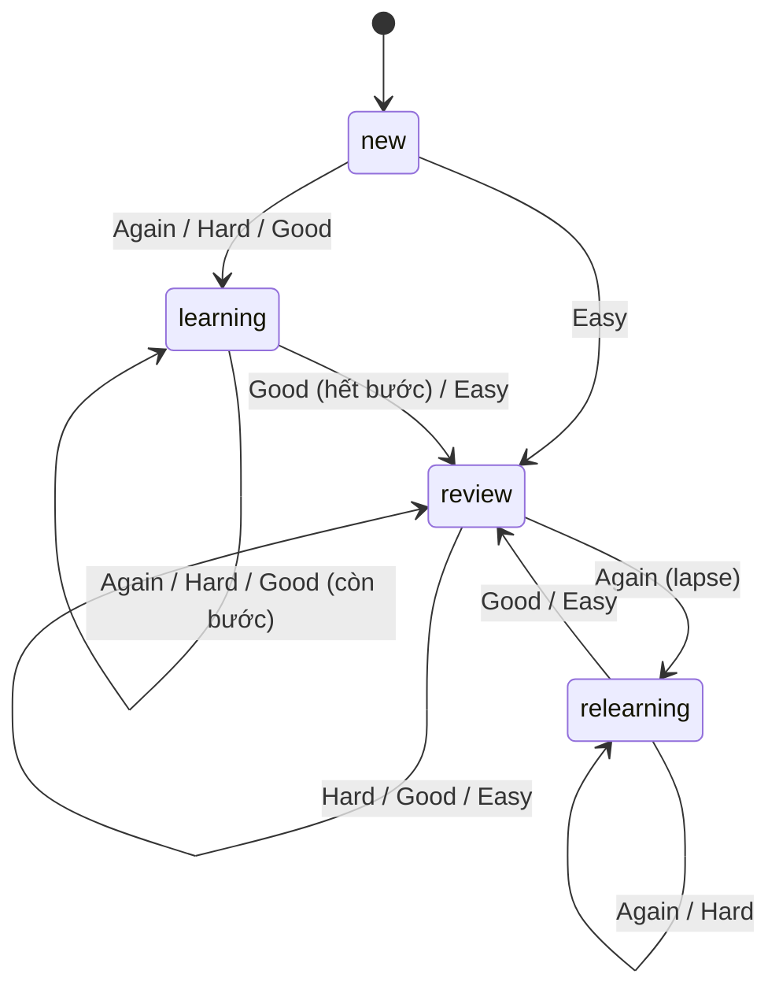
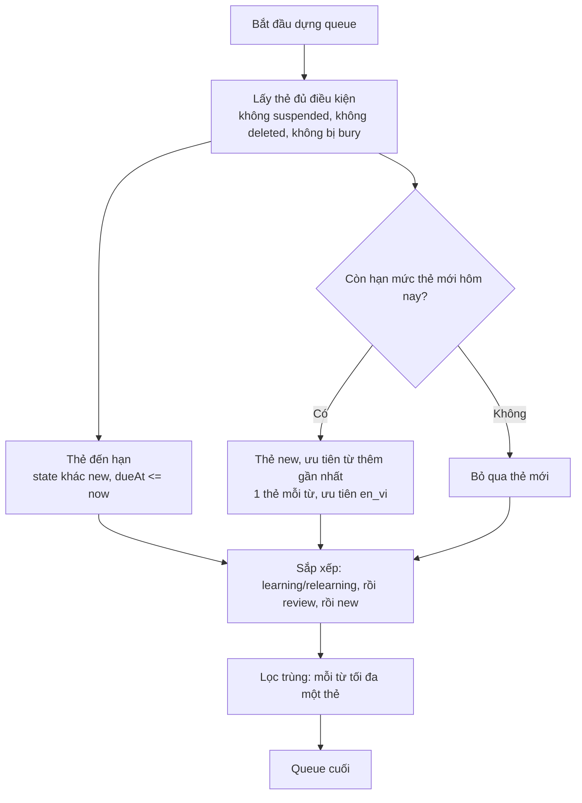
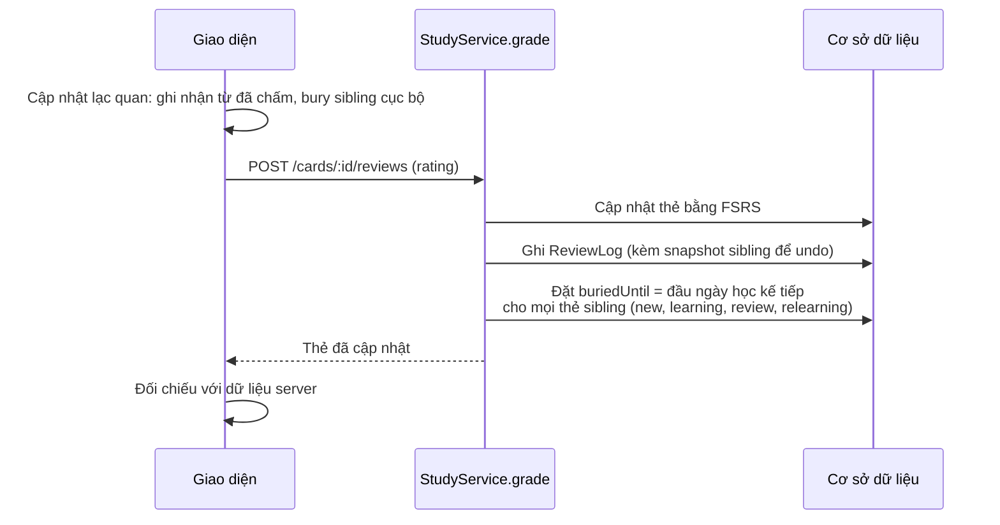

# Thuật toán học và ôn tập từ vựng

Tài liệu mô tả cách Vocelune chọn từ mới, lên lịch ôn tập và tránh lặp lại từ đã học. Code liên quan:

| Thành phần | File |
| --- | --- |
| Lịch FSRS | [`scheduler.ts`](../apps/backend/src/study/scheduler.ts) |
| Queue, chấm điểm, bury, undo | [`study.service.ts`](../apps/backend/src/study/study.service.ts) |
| Ngày học theo múi giờ | [`time.ts`](../apps/backend/src/study/time.ts) |
| Queue phía giao diện | [`StudyConsole.tsx`](../apps/frontend/src/components/study/StudyConsole.tsx), [`VoceluneContext.tsx`](../apps/frontend/src/context/VoceluneContext.tsx) |

## 1. Lịch ôn tập: FSRS-6

Vocelune dùng `ts-fsrs` **5.4.2** (FSRS-6). Mỗi thẻ lưu `stability`, `difficulty`, `state`, `dueAt`, `reps`, `lapses` và `learningSteps`.

| Tham số | Giá trị |
| --- | --- |
| `request_retention` | Theo người dùng, mặc định 0.9 |
| Trọng số `w` | Tùy chỉnh theo người dùng nếu có |
| `learning_steps` | `1m`, `10m` |
| `relearning_steps` | `10m` |
| `enable_fuzz` | `false`, lịch xác định để dễ kiểm thử |

### Máy trạng thái của thẻ

### Khoảng ôn theo đánh giá

| Đánh giá | Thẻ `new` | Thẻ `review` |
| --- | --- | --- |
| Again (1) | +1 phút, vào `learning` | Vào `relearning`, +10 phút |
| Hard (2) | Ở lại bước học | Khoảng ngắn hơn Good |
| Good (3) | +10 phút, sang bước kế | Khoảng theo `stability` |
| Easy (4) | Lên `review` ngay, ít nhất 1 ngày | Khoảng dài nhất |

> [!NOTE]
> Khi chấm Again, Hard hoặc Good cho thẻ mới, từ đó quay lại sau 1–10 phút. Đây là hành vi đúng của learning steps. Chỉ **Easy** đưa thẻ ra khỏi phiên hiện tại.

## 2. Dựng queue học

Mỗi từ (`VocabItem`) có thể có nhiều thẻ (template như `en_vi`). Queue được dựng theo thứ tự:

Hạn mức thẻ mới mỗi ngày bằng `newCardsPerDay` trừ số lượt `new → *` đã ghi trong ngày học. Ngày học bắt đầu lúc `dayStartHour` theo múi giờ của người dùng.

## 3. Tránh lặp lại từ đã đánh giá

Sau mỗi lượt đánh giá, hệ thống **bury** các thẻ cùng từ cho đến đầu ngày học kế tiếp.

Các lớp bảo vệ:

| Lớp | Cơ chế |
| --- | --- |
| Backend | `buriedUntil` cho mọi sibling, gồm cả thẻ `learning` và `relearning`. Trước đây chỉ `new` và `review` bị bury. |
| Backend | Queue lọc trùng theo từ cho mọi state. Trước đây thẻ `learning` và `relearning` bỏ qua bước này. |
| Frontend | `dueCards` và `scopedNewCards` đều bỏ thẻ đang bị bury. |
| Frontend | Từ có thẻ đã học không xuất hiện lại qua thẻ `new` sibling. |
| Frontend | Từ đã chấm trong lần học hiện tại bị loại khỏi scope `ahead` và `all`. |

> [!IMPORTANT]
> Undo (trong 30 giây) khôi phục thẻ và trạng thái `buriedUntil` của sibling, chỉ khi sibling chưa bị ghi đè bởi thao tác sau đó.

## 4. Giới hạn đã biết

- Chưa có giới hạn số thẻ review mỗi ngày và chưa trộn xen thẻ mới với thẻ review. Mọi thẻ đến hạn được xếp trước thẻ mới.
- Thẻ mới ưu tiên từ thêm gần nhất, nên từ cũ có thể bị chậm nếu thêm từ liên tục. Giao diện cho phép đổi sang "từ cũ trước".
- Queue ở giao diện được dựng từ danh sách thẻ cục bộ, còn backend có `GET` queue riêng. Hai nơi cần giữ luật đồng bộ.
- Phép kiểm thử hiện có kiểm tra lịch FSRS và việc bury theo state. Chưa có test tích hợp cho toàn bộ queue vì cần cơ sở dữ liệu.
